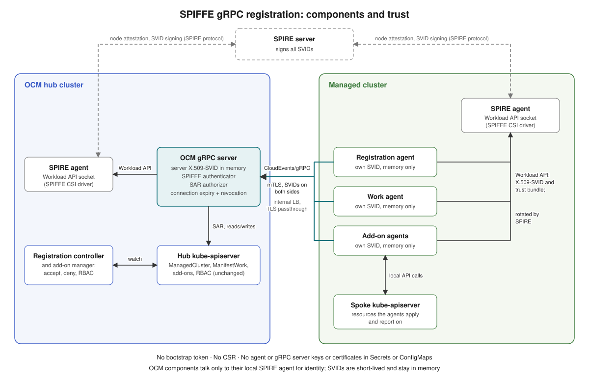
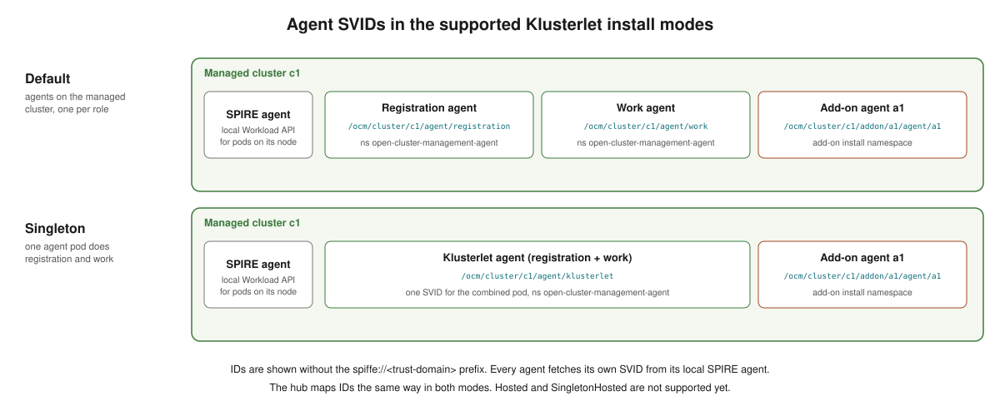
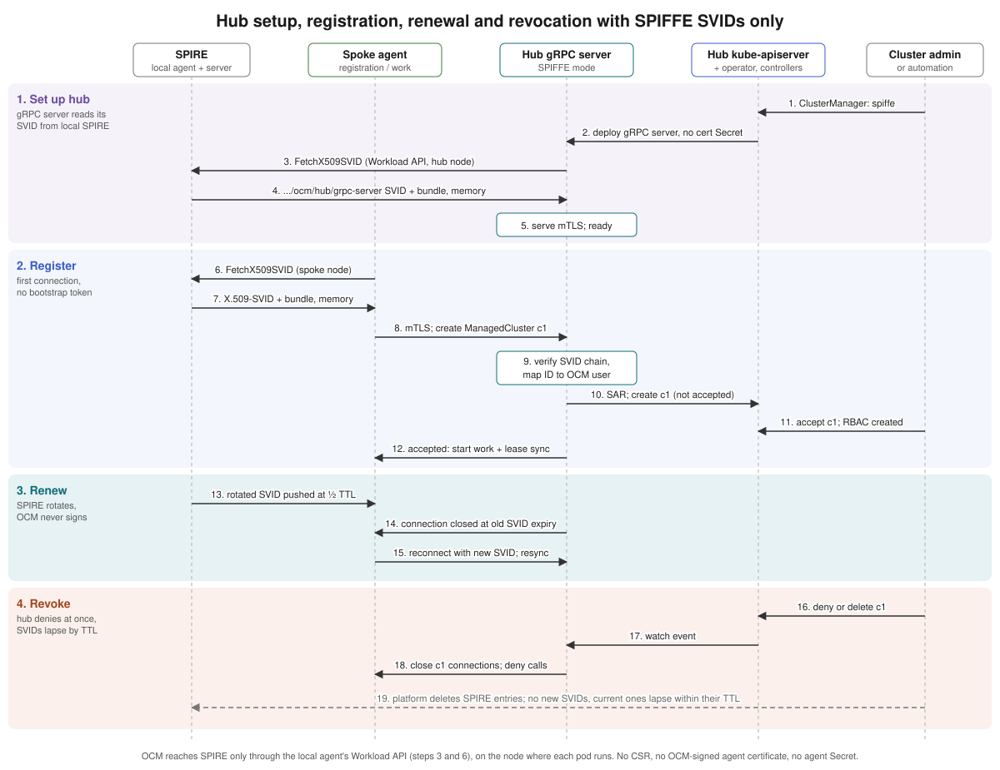

# SPIFFE gRPC registration

## Release Signoff Checklist

- [ ] Enhancement is `implementable`
- [ ] Design details are appropriately documented from clear requirements
- [ ] Test plan is defined
- [ ] Graduation criteria for dev preview, tech preview, GA
- [ ] User-facing documentation is created in [website](https://github.com/open-cluster-management-io/open-cluster-management-io.github.io/)

## Summary

This proposal adds a new registration driver, `spiffe`, in which every OCM agent identity is a
short-lived [SPIFFE](https://spiffe.io/) SVID issued by [SPIRE](https://spiffe.io/docs/latest/spire-about/).
Klusterlet agents and add-on agents connect to the hub gRPC server over mutual TLS with their own
X.509-SVIDs, and the hub gRPC server authenticates with its own X.509-SVID. Registration, renewal
and revocation all work without a bootstrap token, without a CertificateSigningRequest, without
OCM signing a credential for an agent, and without any Secret or ConfigMap that holds a key or
certificate of an agent or of the hub gRPC server. The only identity service OCM talks to is the
local SPIRE agent, through the SPIFFE Workload API.

The driver supports the `Default` and `Singleton` Klusterlet install modes and applies the same
model to add-ons. The `Hosted` and `SingletonHosted` modes are not supported: the Klusterlet API
refuses `spiffe` in them. On the hub, the `ClusterManager` must be in `Default` mode; its `Hosted`
mode is refused in the same way. Supporting the hosted modes is a feature to do later.

An add-on agent reaches the hub only through the gRPC server. An add-on whose agent needs the hub
kube-apiserver, or a certificate signed on the hub, cannot run on a `spiffe` cluster until it is
changed (see [Add-ons](#add-ons)).

The driver is new. It reuses the CloudEvents-over-gRPC transport, the per-resource gRPC services
and the SubjectAccessReview authorizer from [gRPC based registration](../141-grpc-based-registration/README.md),
but replaces its entire identity layer.

## Motivation

The existing registration drivers (`csr`, `grpc`, `awsirsa`) and add-on registration drivers
(`csr`, `token`) all leave long-lived or reusable credentials in OCM's hands:

- A bootstrap kubeconfig or bootstrap token must be distributed to each managed cluster and is
  valid until someone removes it.
- The `csr` and `grpc` drivers have the hub sign client certificates: the hub cluster's own CA
  with `csr`, and OCM's signing key (`signer-secret`) with `grpc`. With `grpc` the hub gRPC server
  also holds a serving certificate in a Secret (`grpc-server-serving-cert`).
- The agent's private key and certificate are written to the `hub-kubeconfig-secret`, and each
  add-on's credentials to `<addon>-hub-kubeconfig` or `<addon>-<signer>-client-cert` Secrets.
  Anyone who can read those Secrets can act as the cluster or the add-on.
- Renewal is OCM's job (CSR rotation), and revoking a cluster or add-on does not invalidate a
  certificate that was already issued.

Many platforms already run SPIRE as their workload identity system. In those environments the
platform wants a single place that issues and rotates identities, short credential lifetimes, and
no key material at rest. OCM should be able to plug into that model instead of running its own
certificate authority.

### Goals

- Add a `spiffe` registration driver to the hub (`ClusterManager`) and the agent (`Klusterlet`).
- Use only SPIRE-issued SVIDs for every Klusterlet agent, every add-on agent and the hub gRPC
  server, for the whole lifecycle: register, renew, revoke and unjoin.
- Support the `Default` and `Singleton` Klusterlet install modes.
- Support add-ons with the same model: each add-on agent registers, renews and is revoked using
  only its own SVID.
- Agents hold only short-lived SVIDs, in memory. Nothing OCM creates stores key material for an
  agent or for the hub gRPC server.
- OCM does not create Secrets or ConfigMaps for the keys or certificates of agents or of the hub
  gRPC server, and does not sign their credentials. The hub's admission webhooks are outside
  this: they keep their serving certificates and the cluster-manager operator's CA, as today (see
  [Operators](#operators)).
- Apart from the local SPIRE agent's Workload API, OCM contacts no other identity or key service
  (no KMS, cloud identity provider, OIDC endpoint or SPIRE server API).
- Keep the hub-side user experience unchanged for clusters: ManagedCluster acceptance, RBAC and
  ManifestWork work as today. Add-ons are enabled the same way and their APIs are unchanged, but
  an add-on's agent has to be written for this driver (see [Add-ons](#add-ons)).
- Allow existing clusters to move to the new driver one at a time.

### Non-Goals

- Installing, configuring or operating SPIRE. SPIRE topology, node attestation and registration
  entries are the platform's responsibility; this proposal only defines what OCM expects of them.
- Changing the existing `csr`, `grpc` or `awsirsa` drivers, or the `csr` and `token` add-on
  drivers.
- Giving agents or add-ons a kubeconfig for the hub kube-apiserver. In this mode they reach the
  hub only through the gRPC server.
- `customSigner` add-on registrations. They exist to have the hub sign client certificates; in
  this mode an add-on that needs a client certificate uses its SVID instead.
- JWT-SVID authentication (see [Alternatives](#alternatives)).
- Protecting agent identities on a managed cluster whose RBAC lets other users run workloads, open
  a shell or create ServiceAccount tokens in OCM's namespaces. As with the existing drivers, that
  is the platform's responsibility. This proposal says what the RBAC must guarantee (see
  [Operators](#operators)).
- The `Hosted` and `SingletonHosted` install modes. There the agents run on a management cluster
  and need a credential for the managed cluster's kube-apiserver, which today is a kubeconfig in a
  Secret (`external-managed-kubeconfig`). That breaks the rule that OCM keeps no long-lived
  credentials. **Feature to do:** support the hosted modes with SVIDs only.
- The `Hosted` mode of the `ClusterManager`. There the hub's controllers, the gRPC server among
  them, run on a management cluster and reach the hub kube-apiserver with a kubeconfig in a
  Secret (`external-hub-kubeconfig`), which breaks the same rule. The `ClusterManager` API
  refuses `spiffe` in that mode.
- The `MultipleHubs` feature (`bootstrapKubeConfigs`). It moves an agent between hubs by choosing
  among bootstrap kubeconfig Secrets, which this driver does not have. The Klusterlet API refuses
  it with `spiffe`.

## Proposal



- **SPIRE** issues every identity. A SPIRE agent runs on each node of the hub and the managed
  clusters, and exposes the Workload API through the SPIFFE CSI driver.
- **Each OCM workload gets its own SVID.** The hub gRPC server, every Klusterlet agent and every
  add-on agent fetch their own X.509-SVID and trust bundle from the Workload API of the cluster
  they run on. SPIRE pushes a new SVID before the current one expires.
- **The hub gRPC server** serves TLS with its SVID, requires a client SVID from the configured
  trust domain, maps the client's SPIFFE ID to an OCM user and groups, and authorizes every
  CloudEvent with SubjectAccessReview, as today.
- **Agents** verify that the server presents the exact hub SPIFFE ID, so a load balancer or a
  certificate from the same trust domain cannot impersonate the hub.

### User Stories

#### Story 1: join a cluster without a bootstrap token

As a platform engineer who already runs SPIRE, I want a managed cluster to join the hub with the
identity SPIRE gives its agents. I create the SPIRE entries for the IDs that `clusteradm join`
prints, and an admin accepts the cluster. No token or kubeconfig is handed over, and OCM has
nothing of its own to rotate afterwards.

#### Story 2: move one existing cluster

As a hub admin, I want to move one `csr` cluster to `spiffe` without touching the others. I add
`spiffe` to the hub's drivers, pin that one cluster to its trust domain, and switch its
Klusterlet. The cluster keeps its `ManagedCluster`, `ManifestWork`s and RBAC, and the other
clusters keep working with their current credentials.

#### Story 3: remove a cluster and keep it out

As a hub admin, I want a deleted cluster to stay deleted. I delete the `ManagedCluster`, and it is
gone as soon as its `ManifestWork`s are cleaned up. The agent's SVIDs from before the deletion are
refused, and once the platform has removed the cluster's SPIRE entries the agent gets no new ones.

#### Story 4: write an add-on agent with no hub kubeconfig

As an add-on author, I want my agent to report to the hub without a stored credential. I build its
hub client with the add-on framework's helper and give the agent a fixed name. The agent then
updates its `ManagedClusterAddOn` with its own SVID.

### SPIFFE ID scheme

The hub derives the OCM identity from the path of the client's SPIFFE ID, so it needs no
per-cluster mapping. The groups are the ones the `csr` and `grpc` drivers and the add-on framework
use today, and the user names have the same form; today the last part of a Klusterlet agent's user
name is a random agent name. The existing RBAC created by the registration controller and the
add-on manager is bound to the groups, so it applies without change, and so do the existing
identity checks.

| Workload | SPIFFE ID | OCM user | OCM groups |
| --- | --- | --- | --- |
| Hub gRPC server | `spiffe://<td>/ocm/hub/grpc-server` | n/a (server) | n/a |
| Registration agent (`Default`) | `spiffe://<td>/ocm/cluster/<cluster>/agent/registration` | `system:open-cluster-management:<cluster>:registration` | `system:open-cluster-management:<cluster>`, `system:open-cluster-management:managed-clusters`, `system:open-cluster-management:spiffe:agents` |
| Work agent (`Default`) | `spiffe://<td>/ocm/cluster/<cluster>/agent/work` | `system:open-cluster-management:<cluster>:work` | same as above |
| Klusterlet agent (`Singleton`) | `spiffe://<td>/ocm/cluster/<cluster>/agent/klusterlet` | `system:open-cluster-management:<cluster>:klusterlet` | same as above |
| Add-on agent (both modes) | `spiffe://<td>/ocm/cluster/<cluster>/addon/<addon>/agent/<agent>` | `system:open-cluster-management:cluster:<cluster>:addon:<addon>:agent:<agent>` | `system:open-cluster-management:cluster:<cluster>:addon:<addon>`, `system:open-cluster-management:addon:<addon>` |

`<td>` is the trust domain configured on the hub. The hub rejects any SVID whose trust domain or
path does not match this scheme, any request where the cluster in the event differs from the
cluster in the SVID, and any add-on request where the add-on in the event differs from the add-on
in the SVID.

The hub also puts every Klusterlet agent it authenticates with an SVID in the group
`system:open-cluster-management:spiffe:agents`. No certificate or token for the hub kube-apiserver
carries that group, whatever a cluster is called: a cluster's own group is
`system:open-cluster-management:<cluster>`, and a cluster name cannot contain a colon. So a
permission bound to the group can be used only through the SPIFFE listener (see "Register" under
[Lifecycle](#lifecycle)).

The platform must make sure SPIRE only issues `.../cluster/<cluster>/...` IDs to workloads that
really belong to cluster `<cluster>`. One part is binding registration entries to the node
attestation of the SPIRE agents that run that cluster's agents. The other part is who may write
the entries: whoever can register entries for a trust domain can register any ID in it, another
cluster's included. See [Risks and Mitigation](#risks-and-mitigation).

### Install modes



The driver supports two of the four Klusterlet install modes. In both, every agent runs on the
managed cluster and gets its SVID from the local SPIRE agent, on the node where the agent's pod
runs. The hub treats both modes the same way: it sees an SVID, maps it, and authorizes the
request.

| Mode | Klusterlet agent pods run on | Klusterlet SVIDs |
| --- | --- | --- |
| `Default` | Managed cluster, `open-cluster-management-agent` | `agent/registration`, `agent/work` |
| `Singleton` | Managed cluster, `open-cluster-management-agent` | `agent/klusterlet` |
| `Hosted` | Not supported | |
| `SingletonHosted` | Not supported | |

- Each Deployment mounts the local Workload API with a `csi.spiffe.io` volume and has no bootstrap
  or hub-kubeconfig Secret volume.
- In `Singleton` mode the one agent pod runs registration and work and has a single SVID. Hub RBAC
  is granted to the cluster's groups, so one identity covers both roles.
- The agents reach the managed cluster's kube-apiserver with their in-cluster ServiceAccounts, as
  today. No kubeconfig for the managed cluster is stored.
- Add-on agents run on the managed cluster. Like the Klusterlet agents, they get their SVIDs from
  the local SPIRE agent.
- **`Hosted` and `SingletonHosted` are not supported.** In those modes the agents run on a
  management cluster and reach the managed cluster's kube-apiserver with a kubeconfig the user
  stores in a Secret (`external-managed-kubeconfig`), which this driver must not rely on. The
  Klusterlet API refuses `authType: spiffe` with either mode, and the klusterlet operator deploys
  no agent for such a Klusterlet. **Feature to do:** support both hosted modes with SVIDs only,
  including access to the managed cluster.
- **The hub must be in `Default` mode.** A `ClusterManager` in `Hosted` mode runs the gRPC server
  on a management cluster, with a kubeconfig Secret for the hub kube-apiserver. The server's SVID
  would come from the management cluster's SPIRE, not the hub's, and the Secret is a stored
  credential of the kind this driver avoids. The `ClusterManager` API refuses the `spiffe` driver
  in that mode.

### Lifecycle



The steps are the same in both supported install modes. "Registration agent" below means the
registration agent in `Default` mode, and the Klusterlet agent in `Singleton` mode.

**Set up the hub.**

1. The platform gives the hub gRPC server pod its identity: SPIRE agents run on the hub nodes, and a
   SPIRE registration entry maps the gRPC server pod (by namespace, ServiceAccount and label) to
   `spiffe://<td>/ocm/hub/grpc-server`. OCM does not create this entry.
2. The admin configures the `ClusterManager` with the `spiffe` driver, for example with
   `clusteradm init`.
3. The cluster-manager operator deploys the gRPC server with a `csi.spiffe.io` volume for the
   local Workload API and no volume for a certificate or a CA bundle. It creates no serving
   certificate for the gRPC server and no bootstrap ServiceAccount or token, and it signs no
   agent certificate.
4. The gRPC server opens a Workload API `X509Source` and receives, in memory, its own X.509-SVID and
   the trust bundle for the trust domain, plus any federated trust domains. It reports not ready
   until the first SVID arrives.
5. It serves mTLS: it presents its SVID and verifies client SVIDs against the trust bundle. SPIRE
   pushes rotated SVIDs and bundle updates over the same stream. New handshakes use them, and
   after a bundle update the server closes the open connections whose SVID the new bundle no
   longer verifies. The server also starts watching `ManagedCluster` and `ManagedClusterAddOn`
   for revocation.

Reading its own SVID and the trust bundle from the local Workload API is all the hub does with
SPIRE. It does not call the SPIRE server, create registration entries, mint SVIDs for agents or
publish a CA bundle for agents; agents get the trust bundle from their own local Workload API.

**Register.**

1. The registration agent fetches its X.509-SVID and trust bundle from the local Workload API and
   keeps them in memory.
2. It dials the hub gRPC endpoint from the `Klusterlet` spec over mTLS, accepting only the
   configured hub SPIFFE ID.
3. The hub verifies the client SVID against the trust bundle from its own Workload API and maps
   the SPIFFE ID to the OCM user and groups above.
4. The agent publishes a create for `ManagedCluster/<cluster>`. The hub allows it only when the
   name equals the cluster in the SVID. The new cluster has `hubAcceptsClient: false`.
5. A cluster admin or automation accepts the cluster, exactly as today. The registration
   controller creates the cluster namespace and RBAC for the cluster's groups.
6. The agent sees the accepted status and starts lease, status, ManifestWork and add-on sync.

There is no bootstrap stage. Before acceptance, the agent's identity is authorized only to create,
get, list and watch its own `ManagedCluster`. The ClusterRole for this cannot name the cluster, so
it covers every `ManagedCluster`; the SPIFFE listener is what holds each agent to its own. The
ClusterRole is therefore bound to `system:open-cluster-management:spiffe:agents`, a group that
only the SPIFFE listener assigns, and not to `system:open-cluster-management:managed-clusters`.
The agents of the `csr` and `grpc` drivers are in `managed-clusters` too, and neither the hub
kube-apiserver nor the existing `grpc` listener holds them to their own cluster for
`ManagedCluster` requests. Bound to that group, the ClusterRole would let such an agent, on a hub
with both drivers, list every `ManagedCluster` and create new ones.

The group's name has one colon more than a cluster's own group,
`system:open-cluster-management:<cluster>`. The hub CSR approval allows an agent certificate
only that group and `managed-clusters`, and a cluster name is a DNS label, so it has no colon. A
group named `...:spiffe-agents` would not be safe: a cluster called `spiffe-agents`, joined with
the `csr` driver, would get exactly that group in its certificate.

**Renew.**

- SPIRE rotates each SVID, by default at half of its TTL, and pushes it over the Workload API. The
  agent's TLS configuration reads the current SVID for each new handshake.
- A gRPC stream authenticates once, when the connection is established. The hub therefore records
  the client SVID's expiry for each connection and closes the connection when that SVID expires.
  The client reconnects with its current SVID and resyncs, as it already does after a reconnect.
- The hub gRPC server renews its own serving SVID the same way.
- OCM never signs, stores or rotates a certificate of an agent or of the hub gRPC server.

**Revoke.**

- **In OCM, immediate.** The hub gRPC server watches `ManagedCluster` and, when a cluster is
  denied (`hubAcceptsClient: false`) or deleted, or its trust-domain pin changes, closes every
  open connection whose SVID belongs to that cluster, including its add-on agents. After a pin
  change, the listener refuses SVIDs from the previous trust domain. On reconnect, the authorizer
  limits what denied or deleted clusters can do:
  - for a denied cluster, its own `ManagedCluster`, lease and events, so the registration agent
    sees when the cluster is accepted again. Work and add-on requests are refused;
  - for a cluster being deleted, `ManifestWork` requests from its work agent (or singleton agent),
    so it can remove what the cluster's `ManifestWork`s applied and the deletion can finish. Every
    other request, and every request of its registration and add-on agents, is refused;
  - for a cluster that was deleted, nothing from an SVID issued before the deletion. The hub
    keeps a record of the deletion for as long as such an SVID can be valid, so the cluster's
    agent cannot create the cluster again with one (see "Deleting a cluster").
- **In SPIRE, within one TTL.** Deleting the cluster's registration entries, or evicting its SPIRE
  agents, stops new SVIDs. SVIDs already issued stop working when they expire. Short TTLs are the
  revocation mechanism; there is no CRL in this design.
- **Trust domain compromise.** SPIRE CA rotation and bundle updates reach OCM through the
  Workload API, with no OCM change. A bundle update by itself affects only new handshakes, so
  the hub also checks the SVID of every open connection against the new bundle and closes the
  ones that no longer verify. It does the same for a trust domain taken out of
  `agentTrustDomains`. Example: the platform replaces a leaked CA. An SVID which that CA signed
  stops working when the new bundle arrives, not up to `maxSVIDLifetime` later.

**Unjoin.** Deleting the `ManagedCluster` on the hub and the `Klusterlet` on the managed cluster
removes everything. There are no OCM Secrets to clean up, and the `ManagedCluster` does not wait
for SVIDs to expire. The platform then removes the cluster's SPIRE entries.

### Add-ons

Add-ons follow the same model. Each add-on agent has its own SVID; the registration agent no
longer obtains credentials on the add-on's behalf.

**Register.**

1. The add-on is enabled on the hub as today, by creating the `ManagedClusterAddOn`. The add-on
   manager sets the add-on's `kubeClient` registration and creates its hub RBAC from the add-on's
   permission configuration, bound to the add-on's user and groups.
2. On the managed cluster, the registration agent sees the registration and, with the `spiffe`
   add-on driver, creates no CSR, no token request and no Secret. It sets
   `status.registrations[].kubeClient.driver: spiffe` and reports the result in a condition of
   its own, `SPIFFEConfigApplied`. `RegistrationApplied` stays the add-on manager's condition;
   the registration agent never writes it.
3. The add-on agent fetches its own SVID (`.../cluster/<cluster>/addon/<addon>/agent/<agent>`)
   from the local Workload API and connects to the hub gRPC server over mTLS, as the Klusterlet
   agents do.
4. The hub maps the SVID to the add-on user and groups, which are the default `kubeClient`
   subject, so the add-on's existing hub RBAC applies.

If an add-on sets a custom `kubeClient` subject that does not match the mapping for its SPIFFE ID,
the add-on manager sets `RegistrationApplied` to false with a clear reason, because no SVID can
carry that subject.

**An add-on says that it is built for this driver.** An agent written for a hub kubeconfig cannot
use an SVID, so support is declared, never assumed. The declaration is the annotation
`addon.open-cluster-management.io/spiffe-supported: "true"` on the `ManagedClusterAddOn`:

- An add-on built with the add-on framework opts in through its registration option, and the
  framework sets the annotation.
- An add-on template carries the annotation on its `AddOnTemplate`, and the ocm add-on manager
  copies it.

On a `spiffe` cluster the registration agent acts on it. With the annotation it writes the
add-on's `<addon>-spiffe` ConfigMap and sets `SPIFFEConfigApplied=True`. Without it, it writes
nothing and sets `SPIFFEConfigApplied=False` with reason `AddOnNotSPIFFEReady`. An add-on manager
built before this driver never sets the annotation, so its add-ons are reported the same way.
Example: managed-serviceaccount, unchanged, on a `spiffe` cluster. Its Deployment still mounts
`managed-serviceaccount-hub-kubeconfig`, which no longer exists, so the Pod does not start, and
its `ManagedClusterAddOn` says `AddOnNotSPIFFEReady`.

**The agent name must be fixed.** The `<agent>` part of an add-on agent's SPIFFE ID is the agent
name in the user of the add-on's `kubeClient` subject, `...:addon:<addon>:agent:<agent>`. The
platform creates a SPIRE entry for that ID, so the name has to stay the same. An add-on that
passes a random agent name to the add-on framework, as the framework's examples do today, gets a
new ID every time its manager restarts, and has to pass a fixed one. Add-on templates already use
`<addon>-agent`. With a fixed name, the ID follows from the template, the cluster, the add-on and
the agent name, so the platform can create the entry before the add-on is enabled (see
[Operators](#operators) for an example entry). The registration agent also writes the rendered ID
to the add-on's `<addon>-spiffe` ConfigMap on the managed cluster.

**What an add-on agent can do on the hub.** In this mode an add-on agent has no kubeconfig for the
hub kube-apiserver. It can use only the resources the hub gRPC server serves, as far as the
add-on's hub RBAC allows: read its own `ManagedClusterAddOn` and update its status and, if
granted, send leases and events in the cluster namespace. The SPIFFE listener serves no CSR and no
token request, so the agent cannot get another credential through it. Example: the agent of the
`helloworld-spiffe` add-on sets a condition on its `ManagedClusterAddOn` every 30 seconds, and
that is all it does on the hub.

**Add-ons that cannot run on a `spiffe` cluster yet.** An add-on whose agent reads or writes other
hub resources with a hub kubeconfig, such as managed-serviceaccount, or needs a certificate from a
`customSigner`, such as cluster-proxy, does not work on a cluster that uses this driver. Its
`ManagedClusterAddOn` shows why, in `SPIFFEConfigApplied`: reason `AddOnNotSPIFFEReady` for an
add-on that has not declared support, and `CustomSignerNotSupported` for a `customSigner`
registration. Because `addOnKubeClientRegistrationDriver` must be `spiffe` when the registration
driver is, this holds for every add-on on the cluster. Such an add-on has to be changed to use
the gRPC services, or wait until the gRPC server offers a way to reach other hub resources (see
[Graduation Criteria](#graduation-criteria)).

**Renew.** Exactly as for the Klusterlet agents: SPIRE rotates the add-on agent's SVID, and the
hub closes connections whose SVID has expired.

**Revoke.**

- Disabling the add-on (deleting the `ManagedClusterAddOn`) makes the add-on manager remove its
  RBAC, and the hub gRPC server closes the add-on agent's open connections for that cluster.
- Denying or deleting the cluster closes the connections of all its add-on agents.
- Deleting the add-on's SPIRE registration entries stops new SVIDs; existing ones lapse within
  their TTL.

**Add-on framework.** The add-on framework gets a helper that builds the add-on agent's
CloudEvents clients from a Workload API `X509Source`, so add-on authors do not handle SVIDs
directly.

### Implementation Details/Notes/Constraints

The examples below use trust domain `ocm-hub.example.org`, managed cluster `cluster1` and add-on
`my-addon`.

#### API

**Hub.** The `ClusterManager` gets a new driver, `spiffe`. Only the trust domain is required; the
other fields have defaults.

```yaml
apiVersion: operator.open-cluster-management.io/v1
kind: ClusterManager
spec:
  registrationConfiguration:
    registrationDrivers:
    - authType: spiffe
      spiffe:
        trustDomain: ocm-hub.example.org
        # Optional. Trust domains the agents may be in, besides trustDomain, which is
        # always accepted. See "Trust domains".
        agentTrustDomains:
        - east.example.org
        # Optional. Default: spiffe://<trustDomain>/ocm/hub/grpc-server
        serverSPIFFEID: spiffe://ocm-hub.example.org/ocm/hub/grpc-server
        # Optional. Default: unix:///spiffe-workload-api/spire-agent.sock
        workloadAPISocket: unix:///spiffe-workload-api/spire-agent.sock
        # Optional. Default: 24h. The longest SVID lifetime the hub accepts from
        # an agent; a longer-lived SVID is refused. The record of a deleted
        # cluster is kept this long; see "Deleting a cluster".
        maxSVIDLifetime: 24h
        # Optional. Default: 5m. How far ahead of the hub's clock SPIRE's may be:
        # an SVID is accepted up to this long before its NotBefore, never after
        # its NotAfter. The deletion records use the same allowance.
        maxClockSkew: 5m
        # Optional. The layout of agent SPIFFE IDs; every Klusterlet must use the
        # same templates. See "ID templates".
        agentIDTemplate: "spiffe://{trustDomain}/ocm/cluster/{cluster}/agent/{role}"
        addOnAgentIDTemplate: "spiffe://{trustDomain}/ocm/cluster/{cluster}/addon/{addon}/agent/{agent}"
        # Optional. With the ManagedClusterAutoApproval feature gate, clusters whose
        # agent's SPIFFE ID matches are accepted on their first join. See "Acceptance".
        autoApprovedIdentities:
        - spiffe://ocm-hub.example.org/ocm/cluster/*/agent/registration
  serverConfiguration:
    endpointsExposure:
    - protocol: grpc-spiffe  # the SPIFFE listener; see gRPC server below
      grpc:
        type: loadBalancer   # must pass TLS through; see Risks
```

**Managed cluster.** The `Klusterlet` says where the hub is and which SPIFFE ID the hub must
present. Neither value is secret, so they go in the spec instead of a bootstrap Secret. The same
fields work in both supported install modes, `Default` and `Singleton`. Add-ons are switched to
SPIFFE with the existing `addOnKubeClientRegistrationDriver` field.

```yaml
apiVersion: operator.open-cluster-management.io/v1
kind: Klusterlet
spec:
  clusterName: cluster1
  deployOption:
    mode: Default            # or Singleton; Hosted and SingletonHosted are refused
  registrationConfiguration:
    registrationDriver:
      authType: spiffe
      spiffe:
        hubEndpoint: ocm-grpc.hub.internal:443
        hubSPIFFEID: spiffe://ocm-hub.example.org/ocm/hub/grpc-server
        workloadAPISocket: unix:///spiffe-workload-api/spire-agent.sock
        # Optional. The agents' own trust domain. Default: the trust domain of hubSPIFFEID.
        trustDomain: ocm-hub.example.org
        # Optional. Must equal the ClusterManager's templates.
        agentIDTemplate: "spiffe://{trustDomain}/ocm/cluster/{cluster}/agent/{role}"
        addOnAgentIDTemplate: "spiffe://{trustDomain}/ocm/cluster/{cluster}/addon/{addon}/agent/{agent}"
    addOnKubeClientRegistrationDriver:
      authType: spiffe       # required when registrationDriver.authType is spiffe
```

**ID templates.** `agentIDTemplate` and `addOnAgentIDTemplate` set the layout of agent SPIFFE IDs,
on the `ClusterManager` and on every `Klusterlet`, which must use the same templates. A template
starts with `spiffe://{trustDomain}/`, where `{trustDomain}` stands for any accepted agent trust
domain. Its path placeholders each fill a whole segment and appear at most once, and at least one
segment is fixed text:

| Placeholder | Agent template | Add-on template |
| --- | --- | --- |
| `{cluster}` | required | required |
| `{role}`: `registration`, `work` or `klusterlet` | required | |
| `{addon}`, `{agent}` | | required |
| `{namespace}`: the namespace the agent runs in | optional | optional |

The hub reads the cluster, role, add-on and agent from an agent's ID with the templates. It never
uses `{namespace}` for authorization, so a platform whose IDs carry the namespace can keep its
layout. The two templates must not be able to match the same ID, and no agent ID may match the
hub server's ID. The CRDs check the form; the operators check the rest and set `Applied=False`
with reason `InvalidSPIFFEConfiguration` when a template is wrong, before rendering anything. The
klusterlet operator renders each agent's ID from the template and records it in
`status.spiffe.agentIDs`; an agent never builds its own ID.

**Trust domains.** The hub accepts agent SVIDs from its own trust domain and from each one listed
in `agentTrustDomains`; its SPIRE must federate with those trust domains. Federation has to be
set on the registration entries of both sides: the hub gRPC server's entry federates with each
agent trust domain, and each agent's entry federates with the hub's, so that each Workload API
returns the other side's bundle (`federatesWith` in a `ClusterSPIFFEID`). Each `ManagedCluster`
is pinned to one trust domain, in the annotation `open-cluster-management.io/spiffe-trust-domain`:

- When an agent creates its cluster, the hub sets the annotation from the trust domain of the
  agent's SVID, whatever the request says.
- A cluster created any other way, by an admin or before the switch from another driver, has no
  pin. The hub serves no SPIFFE agent for it until an admin pins it: by setting the annotation, or
  with `clusteradm accept --spiffe-trust-domain`, which sets it on an unpinned cluster and refuses
  to accept one pinned to another trust domain. This holds with one agent trust domain as well as
  with several. Turning on the `spiffe` driver therefore changes nothing for the clusters that
  are already there: SPIRE can speak for a cluster only after an admin has said so for that
  cluster.
- Only the hub gRPC server and users who may accept the cluster can set or change the pin. That
  is the `managedclusters/accept` permission, which guards `hubAcceptsClient` today. Two checks
  enforce it, one for each way a write reaches the hub:
  - On the hub kube-apiserver, the `ManagedCluster` admission webhook refuses the change from
    anyone else, on create and on update. So an agent of another driver, which updates its
    `ManagedCluster` there directly, can neither pin its cluster nor move it.
  - Through the gRPC server, the webhook sees only the server's own ServiceAccount, which it
    lets through. So the gRPC server's cluster service keeps the pin out of an agent's reach
    itself. On create it sets the pin from the SVID on the SPIFFE listener and drops it on the
    `grpc` listener; on update it copies the pin from the stored object. Whatever the agent's
    request carries is ignored. Today that service writes an agent's annotations as sent.
- The hub refuses every request for a cluster from an SVID in any other trust domain, for the
  Klusterlet and the add-on agents alike.

Without the pin, a federated trust domain could issue `.../ocm/cluster/cluster1/...` IDs and act
as cluster1, because the OCM user comes from the ID's path, not its trust domain.

**Acceptance.** An admin accepts a cluster, as today. With the `ManagedClusterAutoApproval`
feature gate, the hub can also accept a cluster on its first join, and every registration driver
must agree. The `csr` and `grpc` drivers agree to any cluster, because they check
`autoApprovedIdentities` when they approve the cluster's CSR. The `spiffe` driver has no CSR, so
it checks in its accept step instead:

- When an agent creates its cluster, the hub records the agent's SPIFFE ID in the annotation
  `open-cluster-management.io/spiffe-registered-by`, whatever the request says. It is guarded
  like the pin, by the admission webhook and by the gRPC server's cluster service: only the hub
  gRPC server and users who may accept the cluster can set or change it.
- The `spiffe` driver agrees only if that ID matches an entry of `autoApprovedIdentities`. An entry
  is a SPIFFE ID in which `*` stands for one whole path segment. With no entry, a `spiffe` cluster
  is never accepted automatically, even with the feature gate on.
- A cluster no `spiffe` agent registered, for example a `csr` cluster on a hub with both
  drivers, isn't the `spiffe` driver's to decide: it agrees, and the other drivers decide. This is
  no way around `autoApprovedIdentities`. Such a cluster has no pin, so the hub serves no SPIFFE
  agent for it until an admin pins it.
- The `spiffe` driver does not agree while the deletion of a cluster with the same name is on
  record (see "Deleting a cluster"). A cluster that was just deleted comes back accepted only if
  an admin accepts it.

Example: with `spiffe://ocm-hub.example.org/ocm/cluster/*/agent/registration`, a cluster that
cluster1's registration agent creates is accepted at once. A cluster registered by
`spiffe://east.example.org/...`, or by a singleton agent (`.../agent/klusterlet`), waits for an
admin.

**Install modes.** A validation rule on the `Klusterlet` refuses `authType: spiffe` unless
`deployOption.mode` is empty, `Default` or `Singleton`. It applies on create and on update, so a
`spiffe` Klusterlet cannot be moved to a hosted mode either:

```text
spec: Invalid value: registrationDriver.authType spiffe supports only the Default and Singleton install modes
```

The klusterlet operator checks the same rule, for a Klusterlet that got past it, for example
under an older CRD. It deploys no agent, reports no SPIFFE IDs and sets `Applied=False` with
reason `SPIFFEInstallModeNotSupported`. It does this before it looks for any managed-cluster
kubeconfig.

**Cluster name and hubs.** A `spiffe` Klusterlet must set `spec.clusterName`. With the other
drivers an agent without one generates a name and keeps it in `hub-kubeconfig-secret`. This
driver has no such Secret, so the name would change at every restart, and the agents' IDs, for
which the platform creates SPIRE entries, are rendered from it. A `spiffe` Klusterlet must also
leave `bootstrapKubeConfigs` at `None`: the `MultipleHubs` feature chooses among bootstrap
kubeconfig Secrets. The CRD refuses both, on create and on update. The klusterlet operator
checks the same two rules and sets `Applied=False` with reason `InvalidSPIFFEConfiguration`.

**Hub install mode.** A validation rule on the `ClusterManager` refuses a `spiffe` entry in
`registrationDrivers` unless `deployOption.mode` is `Default`. The mode of a `ClusterManager`
cannot be changed once it is applied, so a hub in `Hosted` mode keeps its other drivers. The
cluster-manager operator checks the same rule, for a `ClusterManager` that got past it under an
older CRD: it does not enable the driver, and sets `Applied=False` with reason
`SPIFFEInstallModeNotSupported`.

The `Klusterlet` status gets one new field, `spiffe`, and one new condition,
`SPIFFEAgentRolePolicyApplied` (see [Operators](#operators)). The field holds no key material. Its
`agentIDs` list has the SPIFFE ID of each agent, rendered from the agent ID template. These are
the IDs the platform creates SPIRE entries for; `clusteradm join` prints them. The platform can
create the entries before or after the join: an agent waits, not ready, until its SVID arrives.

```yaml
status:
  spiffe:
    agentIDs:
    - role: registration
      spiffeID: spiffe://ocm-hub.example.org/ocm/cluster/cluster1/agent/registration
    - role: work
      spiffeID: spiffe://ocm-hub.example.org/ocm/cluster/cluster1/agent/work
  conditions:
  - type: SPIFFEAgentRolePolicyApplied
    status: "True"
```

**Add-ons.** `ManagedClusterAddOn` gets one new allowed value, `spiffe`, for the add-on's driver:
`status.registrations[].kubeClient.driver` in `v1beta1`, and `status.kubeClientDriver` in
`v1alpha1`. Both need it, because `v1alpha1` is the stored version and a `v1beta1` value is
converted into it. The registration agent sets the driver so the hub can see how the add-on
authenticates. No new registration type is needed. The API also gets one condition type,
`SPIFFEConfigApplied`, which the registration agent sets, and one annotation,
`addon.open-cluster-management.io/spiffe-supported` (see [Add-ons](#add-ons)).

All new fields sit behind a new `SPIFFERegistration` feature gate.

**New names at a glance.**

| Kind | Name | On | Set by |
| --- | --- | --- | --- |
| Feature gate | `SPIFFERegistration` | hub and agents | admin |
| Annotation | `open-cluster-management.io/spiffe-trust-domain` | `ManagedCluster` | hub gRPC server, or a user who may accept the cluster |
| Annotation | `open-cluster-management.io/spiffe-registered-by` | `ManagedCluster` | hub gRPC server |
| Annotation | `addon.open-cluster-management.io/spiffe-supported` | `ManagedClusterAddOn`, `AddOnTemplate` | add-on manager, add-on template author |
| Finalizer | `open-cluster-management.io/spiffe-revocation` | `ManagedCluster` | hub gRPC server, `ManagedCluster` mutating webhook, registration controller |
| Group | `system:open-cluster-management:spiffe:agents` | Klusterlet agents on the SPIFFE listener | hub gRPC server |
| Label | `open-cluster-management.io/spiffe-role` | agent and add-on Pods | klusterlet operator, add-on framework, ocm add-on manager |
| Condition | `SPIFFEAgentRolePolicyApplied` | `Klusterlet` | klusterlet operator |
| Condition reasons | `InvalidSPIFFEConfiguration`, `SPIFFEInstallModeNotSupported` | `Klusterlet` and `ClusterManager`, `Applied` | klusterlet operator, cluster-manager operator |
| Condition reason | `HubConnectionNotChecked` | `Klusterlet`, `HubConnectionDegraded` | klusterlet operator |
| Condition | `SPIFFEConfigApplied`, with reasons `AddOnNotSPIFFEReady` and `CustomSignerNotSupported` | `ManagedClusterAddOn` | registration agent |
| Condition reason | `SubjectNotSupportedBySPIFFE` | `ManagedClusterAddOn`, `RegistrationApplied` | add-on manager |
| ConfigMap | `<addon>-spiffe` | add-on install namespace | registration agent |
| ConfigMap | deletion record, named after the deleted cluster's UID | hub namespace | registration controller |
| Listener | `grpc-spiffe`, Service `cluster-manager-grpc-server-spiffe` | hub | cluster-manager operator |
| ClusterRole | `klusterlet-spiffe` | managed cluster | Helm chart or kustomize |

#### Operators

**Hub (cluster-manager operator).** With the `grpc` driver it gives the gRPC server a serving
certificate (`grpc-server-serving-cert`) and a CA bundle to verify agents with, and has the
registration controller sign agent certificates with its CA (`signer-secret`). The installation
also provides a bootstrap ServiceAccount or token. In `spiffe` mode none of that exists. The
operator only mounts a `csi.spiffe.io` volume, which puts the local SPIRE agent's Workload API
socket into the pod.

The operator's CA does not go away. `signer-secret`, `ca-bundle-configmap` and the serving
certificates of the hub's admission webhooks exist on every hub, whatever its drivers, and this
proposal leaves them alone. They authenticate the webhooks to the hub kube-apiserver, and no
agent presents or verifies anything they sign. They still matter here: the `ManagedCluster`
webhook guards the trust-domain pin (see "Trust domains"), so the pin is only as safe as that
webhook and its CA, which a hub admin controls, as today.

**Managed cluster (klusterlet operator).** Today the agents start from a
`bootstrap-hub-kubeconfig` Secret and the registration agent writes its credentials to
`hub-kubeconfig-secret`. In `spiffe` mode neither Secret exists. Each agent Deployment
(`klusterlet-registration` and `klusterlet-work`, or the single `klusterlet-agent`) gets the same
CSI volume and fetches its own SVID.

The no-key-material rule covers every hub credential: agent and add-on identities toward the hub
and the hub gRPC server's own identity. There is no managed-cluster credential to store either:
the agents run on the managed cluster and use their in-cluster ServiceAccounts. That is why only
`Default` and `Singleton` are supported.

**A label so SPIRE can tell the agents apart.** OCM does not create SPIRE registration entries;
the platform does. Entries pick pods by properties such as namespace and ServiceAccount. That is
not enough here: the singleton agent and the default-mode work agent both use the ServiceAccount
`<klusterlet>-work-sa`. So every agent pod gets a label, `open-cluster-management.io/spiffe-role`,
with the value `registration`, `work` or `klusterlet`. A label alone is not enough either, because
anyone who can create a pod in the namespace can set it. Entries must therefore select on the
namespace, the ServiceAccount and the role label together. For example, with the SPIRE controller
manager, for the work agent of a Klusterlet named `klusterlet` in `Default` mode:

```yaml
apiVersion: spire.spiffe.io/v1alpha1
kind: ClusterSPIFFEID
metadata:
  name: ocm-work-agent
spec:
  spiffeIDTemplate: "spiffe://ocm-hub.example.org/ocm/cluster/cluster1/agent/work"
  namespaceSelector:
    matchLabels:
      kubernetes.io/metadata.name: open-cluster-management-agent
  podSelector:
    matchLabels:
      open-cluster-management.io/spiffe-role: work
  workloadSelectorTemplates:
  - "k8s:sa:klusterlet-work-sa"   # SPIRE also checks the pod's ServiceAccount
```

**Who can get an agent's SVID.** SPIRE gives an SVID to any pod that matches an entry's selectors.
It does not look at who created the pod, or at what the pod runs. So these are the people and
components that can act as a cluster's agents:

- Cluster admins of the managed cluster, and anyone with access to its nodes.
- Anyone who can, in one of OCM's namespaces, start a pod with an agent's ServiceAccount, get into
  an agent pod, or act as one of OCM's ServiceAccounts. OCM's namespaces are the operator
  namespace, the agent namespace and the add-on install namespaces.
- Hub users who can create `ManifestWork`s for the cluster that run with the work agent's own
  permissions (the default executor). The work agent applies their manifests, and it is `admin`
  in every namespace of the managed cluster, the agent namespace included.
- Whoever can write SPIRE registration entries for the trust domain, or sign for it. They can
  register any ID in the trust domain, not only this cluster's (see
  [Risks and Mitigation](#risks-and-mitigation)).

Apart from the last one, the existing drivers trust the same set: there, the same people can read
the `hub-kubeconfig-secret`, or start a pod that mounts it. What changes is what they get. With
`spiffe` it is a short-lived SVID that stays in memory, one hour with SPIRE's default TTL, not a
key and certificate in a Secret that stay valid until the certificate expires.

**What the managed cluster's RBAC must guarantee.** OCM relies on the managed cluster's RBAC to
keep everyone else out, as the existing drivers do. In the operator namespace, the agent namespace
and every add-on install namespace, only cluster admins, Kubernetes' built-in controllers, and the
ServiceAccounts of OCM and of the add-ons themselves may:

- create or change Pods, Deployments, ReplicaSets, StatefulSets, DaemonSets, Jobs and CronJobs;
- use `pods/exec`, `pods/attach` or `pods/ephemeralcontainers`. A process started that way runs
  inside the agent's pod and gets the agent's SVID, because SPIRE attests the pod, not the process;
- create ServiceAccount tokens (`serviceaccounts/token`), impersonate ServiceAccounts, or read or
  create Secrets. A Secret of type `kubernetes.io/service-account-token` gets a long-lived token
  for the ServiceAccount it names.
- create or change ConfigMaps in an add-on install namespace. The `<addon>-spiffe` ConfigMap
  there tells the add-on agent where the hub is and which SPIFFE ID the hub must present.
  Changed, it sends the agent to another server that holds an SVID in a trust domain the agent
  trusts.

The built-in `edit` and `admin` ClusterRoles include all of these except
`pods/ephemeralcontainers`, so they must not be bound in those namespaces, neither by a
RoleBinding there nor by a ClusterRoleBinding. `nodes/proxy` reaches the kubelet directly and must
be limited to cluster admins.

Example: a user who may create a token for `klusterlet-work-sa` can act as the work agent. The work
agent is `admin` in every namespace, so that user can then start any pod in the agent namespace
and get an agent's SVID.

**OCM creates only its own RBAC.** The Helm chart, which `clusteradm join` uses too, installs the
operator's ServiceAccount and ClusterRole. The operator then creates the agents' ServiceAccounts,
Roles and bindings when it reconciles the `Klusterlet`. Nothing OCM installs gives anyone else
access to these namespaces. OCM cannot make sure that nobody else has it, though. RBAC only adds
permissions: a binding the platform created, such as `edit` for a team in every namespace, covers
OCM's namespaces too, and OCM cannot take it away. The platform checks it, for example:

```shell
# Who is bound in the namespace, and who is bound in every namespace. Look at the
# Group subjects as well as the users and ServiceAccounts.
kubectl get rolebindings -n open-cluster-management-agent -o wide
kubectl get clusterrolebindings -o wide

# Each must answer "no" for every user and ServiceAccount that is not a cluster admin
# or one of OCM's own ServiceAccounts. --as alone asks for the user without its
# groups, so name the user's groups with --as-group.
kubectl auth can-i create pods -n open-cluster-management-agent \
  --as <user> --as-group <group>
kubectl auth can-i create pods/exec -n open-cluster-management-agent \
  --as <user> --as-group <group>
kubectl auth can-i create serviceaccounts/token -n open-cluster-management-agent \
  --as <user> --as-group <group>
kubectl auth can-i update configmaps -n open-cluster-management-agent-addon \
  --as <user> --as-group <group>
```

Example: `edit` is bound to the group `dev-team` in every namespace, and alice is a member.
`--as alice` answers `no`. `--as alice --as-group dev-team` answers `yes`.

**The one check RBAC cannot express.** RBAC decides who may create a Pod. It cannot say how the
Pod's fields must relate. SPIRE tells the singleton agent and the work agent apart by the role
label alone, so the label must always match the ServiceAccount. In `spiffe` mode the klusterlet
operator installs one ValidatingAdmissionPolicy and its binding,
`ocm-spiffe-agent-roles-<klusterlet>`, for the agent namespace. A Pod that uses one of this
Klusterlet's agent ServiceAccounts must carry the matching `spiffe-role` label, and the label may
not change afterwards. These are the pairs for a Klusterlet named `<klusterlet>`:

| Install mode | ServiceAccount | `spiffe-role` |
| --- | --- | --- |
| `Default` | `<klusterlet>-registration-sa` | `registration` |
| `Default` | `<klusterlet>-work-sa` | `work` |
| `Singleton` | `<klusterlet>-work-sa` | `klusterlet` |

Example: in `Default` mode, a Pod with `klusterlet-work-sa` and `spiffe-role: klusterlet` is
refused.

- The policy looks only at the Pod, never at who creates it. It is not a security boundary:
  whoever may create Pods in the agent namespace is trusted already. It makes a wrong label fail
  when the Pod is created, not later as an SVID that never arrives.
- It checks only Pods that use this Klusterlet's ServiceAccounts. Pods of another Klusterlet, or of
  an add-on, in the same namespace are not refused.
- ValidatingAdmissionPolicy is GA from Kubernetes 1.30. On an older cluster the operator installs
  nothing and sets the Klusterlet condition `SPIFFEAgentRolePolicyApplied` to `False` with reason
  `NotServed`. It deploys the agents all the same.
- The permission to manage the policy and its binding is in a separate ClusterRole,
  `klusterlet-spiffe`, installed only where it is used. The Helm chart renders it when
  `klusterlet.registrationConfiguration` uses `spiffe`, or with the value `enableSPIFFE: true` for
  a `spiffe` Klusterlet created outside the chart; `clusteradm join` uses the chart. With
  kustomize, `deploy/klusterlet/spiffe` is the default install plus this ClusterRole. The OLM
  bundle does not include it. Without it the operator sets `SPIFFEAgentRolePolicyApplied` to
  `False` with reason `PermissionsMissing`, and deploys the agents all the same.
- An operator with no `spiffe` Klusterlet never looks up, lists or watches the admission APIs, and
  needs no permission on them, on any Kubernetes version.

**Add-on agents.** Add-on pods use their own ServiceAccounts and the role label value `addon`,
which the add-on framework sets, or ocm for an add-on template. An add-on's SPIRE entry selects
on its install namespace, its ServiceAccount and that label. For example, for the agent of
`my-addon` on `cluster1`:

```yaml
apiVersion: spire.spiffe.io/v1alpha1
kind: ClusterSPIFFEID
metadata:
  name: ocm-cluster1-my-addon
spec:
  spiffeIDTemplate: "spiffe://ocm-hub.example.org/ocm/cluster/cluster1/addon/my-addon/agent/my-addon-agent"
  namespaceSelector:
    matchLabels:
      kubernetes.io/metadata.name: open-cluster-management-agent-addon
  podSelector:
    matchLabels:
      open-cluster-management.io/spiffe-role: addon
  workloadSelectorTemplates:
  - "k8s:sa:my-addon-agent-sa"
```

An add-on can be installed in any namespace, and nothing in this driver blocks or deletes other
workloads there. The RBAC requirement above holds for that namespace too. In a namespace shared
with other applications, whoever can start pods there can get the add-on's SVID, as they can read
the add-on's hub kubeconfig Secret today. An add-on that has to be kept apart needs a namespace of
its own.

Every add-on workload is applied by the work agent from a `ManifestWork`, so whoever writes one
add-on's manifests can also use another add-on's ServiceAccount in the same namespace. Add-on
managers are trusted for the clusters they manage, as today.

#### sdk-go

sdk-go holds the shared gRPC server and client code, so most of the SPIFFE logic lives here.

- **Server identity check** (`pkg/server/grpc/authn`). A new `SPIFFEAuthenticator` reads the
  client's verified SVID and turns its SPIFFE ID into an OCM user and groups. For example,
  `spiffe://ocm-hub.example.org/ocm/cluster/cluster1/agent/work` becomes user
  `system:open-cluster-management:cluster1:work` with groups `system:open-cluster-management:cluster1`,
  `system:open-cluster-management:managed-clusters`, `system:open-cluster-management:spiffe:agents`
  and `system:authenticated`. It rejects IDs from another trust domain, or IDs that do not follow
  the scheme, such as `.../ocm/something-else`. It also notes when the SVID expires.

  Only this authenticator assigns `system:open-cluster-management:spiffe:agents`, and only to
  Klusterlet agents. The pre-acceptance permission is bound to it, so that permission cannot be
  used by an agent of another driver (see "Register").

  Every mapped identity gets `system:authenticated`, as the kube-apiserver gives every
  authenticated user today. The hub sends exactly these groups in its SubjectAccessReviews, so
  without it a permission bound to `system:authenticated`, which works for an agent today, would
  be denied after the switch to `spiffe`.
- **Picking the right SVID** (`pkg/spiffe`). The
  Workload API can return several SVIDs for one pod, for example when the platform also gives
  every pod a generic identity, and `X509Source` uses the first one by default. Each OCM component
  therefore opens its source with `workloadapi.WithDefaultX509SVIDPicker` and picks the SVID whose
  SPIFFE ID it expects: the configured `serverSPIFFEID` for the hub gRPC server, and the ID built
  from the cluster name and role for an agent (for example
  `spiffe://ocm-hub.example.org/ocm/cluster/cluster1/agent/work`). If no SVID with that ID is
  present, the component reports not ready, with the IDs it did receive, instead of presenting
  another identity. `pkg/spiffe/idtemplate` parses and renders the ID templates (see API).
- **Server TLS** (`pkg/server/grpc/spiffe`). The server builds its TLS settings from the local Workload API
  (go-spiffe `workloadapi.X509Source` and `tlsconfig.MTLSServerConfig`) instead of certificate
  files. The server enforces SVID expiry on the connection, not the stream. A gRPC
  `TransportCredentials` wrapper around the SPIFFE TLS credentials records the peer's SPIFFE ID and
  SVID expiry after each handshake. It registers the underlying `net.Conn` in a connection registry
  and arms a timer that closes the `net.Conn` when the SVID expires. That ends the HTTP/2 connection
  and every stream and unary call on it. For example, if an agent connects at 10:40 with an SVID
  valid until 11:00, the hub closes that connection at 11:00. The agent then opens a new connection,
  with a new handshake, using its newer SVID. As a second check, unary and stream interceptors in
  `pkg/server/grpc/authn` reject any RPC whose peer SVID has already expired. The wrapper also
  refuses, in the handshake, a client SVID that lives longer than the configured maximum, and
  records the SVID's `NotBefore` for the deletion records (see "Deleting a cluster"). It applies
  `maxClockSkew` to `NotBefore` only: an SVID is never accepted after its `NotAfter`.

  The registry keeps the peer certificate chain of each connection. When the Workload API
  delivers a new trust bundle, the server verifies every registered chain against it and closes
  the connections that fail. It does the same when a trust domain is no longer accepted.
- **Client TLS** (`pkg/cloudevents/generic/options/grpc`). A client option dials the hub with the
  agent's SVID and accepts only the configured hub ID:
  `tlsconfig.MTLSClientConfig(source, source, tlsconfig.AuthorizeID(hubSPIFFEID))`. A server that
  presents any other ID, even one from the same trust domain, is refused.

  In Alpha the client reconnects only after the hub has closed the connection at SVID expiry. For
  Beta the client reconnects by itself: when SPIRE delivers a renewed SVID, it opens a new
  connection with it, moves its subscriptions over and closes the old one, long before the old
  SVID expires. The hub's close at expiry stays as a backstop, and such a close no longer makes
  the client's reconnect wait grow.
- **New dependency:** `github.com/spiffe/go-spiffe/v2`.

#### ocm

- **New registration driver** (`pkg/registration/register/spiffe`). Builds the agent's gRPC
  clients from its SVID. It has no CSR step, no Secret handling and no bootstrap phase. The agent
  can talk to the hub as long as it has a current SVID and the cluster is accepted. For add-ons it
  only reports the registration status; it creates no credentials. Its hub side decides only
  automatic acceptance against `autoApprovedIdentities` (see "Acceptance"); the cluster-manager
  operator passes them to the hub as `--spiffe-auto-approved-identities`.
- **Add-on registration on the managed cluster** (`pkg/registration/spoke/addon`). With the
  `spiffe` add-on driver, the registration agent no longer creates a CSR, token or
  `<addon>-hub-kubeconfig` Secret for `kubeClient` registrations. The `csr` and `token` drivers
  report in conditions of their own, `ClusterCertificateRotated` and `TokenRefreshed`. The
  `spiffe` driver does the same, in `SPIFFEConfigApplied`:
  - `True` once it has written the add-on's `<addon>-spiffe` ConfigMap.
  - `False` with reason `AddOnNotSPIFFEReady` when the `ManagedClusterAddOn` lacks the
    `spiffe-supported` annotation. It writes no ConfigMap.
  - `False` with reason `CustomSignerNotSupported` for a `customSigner` registration, because
    the hub does not sign certificates in this mode.

  It does not write `RegistrationApplied`; only the add-on manager does.
- **Add-on manager on the hub** (addon-framework `pkg/addonmanager/controllers/registration`,
  which the ocm add-on manager runs). Checks that an add-on's `kubeClient` subject can be carried
  by an SVID. For example, the default subject
  `system:open-cluster-management:cluster:cluster1:addon:my-addon:agent:my-addon-agent` matches
  `spiffe://ocm-hub.example.org/ocm/cluster/cluster1/addon/my-addon/agent/my-addon-agent`, but a
  custom user such as `my-team-bot` cannot, so the add-on gets a `RegistrationApplied=False`
  condition with reason `SubjectNotSupportedBySPIFFE`. The comparison uses the full mapped
  identity, including `system:authenticated`, so a default subject that lists that group still
  matches.
- **Add-on templates** (`pkg/addon/templateagent`). An add-on made from an `AddOnTemplate` does
  not go through the add-on framework's rendering: ocm's own decorator puts the hub kubeconfig
  into its workloads. For a template that declares SPIFFE support, on a cluster whose
  registration agent has reported `driver: spiffe`, the decorator changes what it adds:
  - It mounts the `<addon>-spiffe` ConfigMap where it mounts the `<addon>-hub-kubeconfig`
    Secret today, as volume `hub-kubeconfig` at `/managed/hub-kubeconfig`.
  - It adds the `csi.spiffe.io` volume to every container, init containers too.
  - It sets the `spiffe-role: addon` label on the Pod.
  - It no longer sets `HUB_KUBECONFIG`.

  The add-on manager copies the template's `spiffe-supported` annotation to the
  `ManagedClusterAddOn`. Unit tests cover Deployments, DaemonSets and StatefulSets.
- **gRPC server** (`pkg/server/grpc`). The `spiffe` driver gets its own listener, on its own port
  and Service (`cluster-manager-grpc-server-spiffe`), exposed through an `endpointsExposure` entry
  with `protocol: grpc-spiffe`. That listener uses only the SPIFFE TLS credentials and the SPIFFE
  authenticator (no tokens, no OCM-signed certificates) and does not offer the CSR and
  token-request services.
  - When `spiffe` is the only driver, only this listener runs. The operator creates no gRPC
    serving certificate, and its CA signs nothing but the admission webhooks' serving
    certificates (see Operators).
  - When `spiffe` is listed with `grpc` for migration, the existing `grpc` listener keeps running
    unchanged on its current port, with its current authentication and its CSR and token-request
    services. Agents that have not migrated keep working.
  - Both listeners share the same CloudEvents services and authorizer, so a cluster sees the same
    resources whichever one it uses. When `grpc` is removed from `registrationDrivers`, its
    listener and its serving certificate are removed.

  The server watches `ManagedCluster` and `ManagedClusterAddOn`. When a cluster is denied or
  deleted, its trust-domain pin changes, or an add-on is disabled, it closes the matching
  connections right away through the connection registry described under sdk-go. A trust bundle
  update closes the connections it no longer verifies in the same way.

  Two checks decide what a reconnecting agent of such a cluster may do. Before the
  SubjectAccessReview, a gate on the listener refuses by identity: an existing cluster must be
  pinned, and the SVID's trust domain must be the one it is pinned to; the registration and add-on
  agents of a cluster being deleted, the work and add-on agents of a denied cluster, and the agent
  of a disabled add-on are refused. So is an SVID issued before a deletion of its cluster that is
  still on record (see "Deleting a cluster").

  Inside the SubjectAccessReview authorizer, once the request's data type is known, a second check
  (sdk-go `SARAuthorizer.WithSPIFFECheck`) allows a cluster being deleted only `ManifestWork`
  requests and a denied cluster only its `ManagedCluster`, lease and events. The second check is
  what holds the singleton agent, whose one identity is both the registration and the work agent,
  to the same rules.

  The cluster service (`pkg/server/services/cluster`) owns three fields of a `ManagedCluster`:
  the `spiffe-trust-domain` and `spiffe-registered-by` annotations and the `spiffe-revocation`
  finalizer. Today it writes what the agent sent, apart from the ClusterSet label, and it writes
  with the gRPC server's ServiceAccount, so the admission webhook cannot tell what the agent
  asked for from what the server decided. The service therefore sets these fields itself, on
  both listeners:
  - On create through the SPIFFE listener, it sets the two annotations from the SVID and adds
    the finalizer.
  - On create through the `grpc` listener, it removes all three from the request.
  - On every update, it copies all three from the stored object.

  Example: the agent of an accepted `grpc` cluster sends an update that adds
  `spiffe-trust-domain: east.example.org`. The stored cluster has no pin, so the update is written
  without one, and the hub still serves no SPIFFE agent for that cluster.
- **Deleting a cluster** (`pkg/registration/hub`). Closing connections does not cancel an SVID
  that is still valid. Without a guard, an agent whose cluster was just deleted could reconnect and
  use its pre-acceptance permission to create the `ManagedCluster` again. The hub does not wait
  for those SVIDs to expire. It remembers the deletion and refuses the SVIDs issued before it:
  - **A limit on SVID lifetime.** In the TLS handshake, the hub refuses an agent SVID whose
    lifetime (`NotAfter` minus `NotBefore`) is longer than `spiffe.maxSVIDLifetime` from the
    `ClusterManager` (default `24h`). The setting has to be a little above SPIRE's TTL, because
    SPIRE dates `NotBefore` a few seconds back. If the platform raises SPIRE's TTL above the limit,
    the agents fail to connect, with an error that names the setting. The guard is never weakened
    without anyone noticing.
  - **A deletion record.** Each `ManagedCluster` pinned to a trust domain (see "Trust domains")
    has the finalizer `open-cluster-management.io/spiffe-revocation`. The finalizer is added by
    the write that pins the cluster, not afterwards: by the gRPC server when an agent creates the
    cluster, and by the `ManagedCluster` mutating webhook when an admin sets the pin. So a
    cluster deleted a moment after it was created, or while the registration controller is down,
    still leaves a record: the finalizer holds the object until the controller is back. The
    finalizer stays when the pin is removed later.

    When the cluster is deleted, the registration controller writes a record and then removes
    the finalizer at once. The record is a ConfigMap in the hub namespace, named after the
    deleted object's UID. It holds the cluster's name and its deletion time, and nothing secret.
    The controller deletes the record when the deletion time plus `maxSVIDLifetime` plus
    `maxClockSkew` (default `5m`) has passed. By then every SVID the record refuses has expired:
    such an SVID was issued before the deletion time plus `maxClockSkew`, and lives no longer
    than `maxSVIDLifetime`. This holds because the hub never accepts an SVID after its
    `NotAfter`; `maxClockSkew` is an allowance on `NotBefore` only.
  - **What a record does.** While a record for a cluster exists, the hub refuses every request
    for that cluster from an SVID issued earlier than the deletion time plus `maxClockSkew`. The
    hub reads the issue time from the SVID's `NotBefore`, which SPIRE sets to the time of issue,
    a few seconds back. The skew term covers a SPIRE server whose clock is ahead of the hub's.
    For a request to create the cluster, the hub reads the records from the API server and not
    from a cache, so a record written a moment ago counts.

    There is one exception: while the deleted object still exists, its work agent may send
    `ManifestWork` requests, to remove what the cluster's `ManifestWork`s applied. The hub deletes
    the `ManifestWork`s and keeps the work agent's RoleBinding until they are gone, as with the
    other drivers. The `spiffe` driver also never accepts a cluster automatically while a record
    for its name exists.
  - **Nothing waits.** The `ManagedCluster` goes away as soon as its `ManifestWork`s are cleaned
    up, as with the other drivers, and its name is free again.

  Example: SVIDs live 1 hour and `c1` is deleted at 10:40. The work agent, whose SVID is from
  10:20, cleans up `c1`'s `ManifestWork`s, and `c1` is gone at 10:41. The registration agent
  reconnects with its SVID from 10:25 and tries to create `c1`. The hub refuses, because 10:25 is
  before 10:45. If SPIRE still issues SVIDs for `c1`, the agent's SVID is renewed at 10:55. With
  that one the agent creates `c1` again, as a new cluster that waits for an admin, even if its ID
  is in `autoApprovedIdentities`.

  To keep the cluster out for good, the platform removes the cluster's SPIRE registration entries
  and what creates them. With the SPIRE controller manager, that means deleting or changing the
  cluster's `ClusterSPIFFEID` objects; deleting only the generated entries is not enough, because
  the controller manager recreates them on its next reconcile. The order is not critical. The
  best one is to delete the `ManagedCluster` first and remove the entries once it is gone, so the
  work agent has a valid SVID for the cleanup. If the entries are removed late, the worst case is
  the one in the example: the cluster shows up again, not accepted, and the admin deletes it once
  more.

  The finalizer and the records follow the `SPIFFERegistration` feature gate, not the list of
  drivers. While the gate is on, the registration controller writes a record for every deleted
  cluster that has the finalizer, also when `spiffe` is not in `registrationDrivers`. Removing
  the driver and adding it again therefore opens no gap. Records are deleted only while the
  driver is listed, because their lifetime comes from its settings.

  When the gate is turned off, the registration controller removes the finalizer from every
  `ManagedCluster`, so no cluster is left that cannot be deleted. A cluster deleted while the
  gate is off leaves no record. When the gate is turned on again, the controller puts the
  finalizer back on the pinned clusters. An admin who turns it on again within `maxSVIDLifetime`
  first removes the SPIRE entries of the clusters deleted in between.
- **Operators** (`pkg/operator`). Render the SPIFFE version of the gRPC server Deployment and of
  each agent Deployment, for the `Default` and `Singleton` install modes. Refuse a `spiffe`
  Klusterlet in a hosted mode, without a cluster name or with `bootstrapKubeConfigs`, and the
  `spiffe` driver on a `ClusterManager` in `Hosted` mode (see API).

  The klusterlet operator also stops waiting for `hub-kubeconfig-secret`. Today it checks that
  Secret to set `HubConnectionDegraded`, and keeps the work agent at zero replicas until the
  Secret exists. A `spiffe` Klusterlet never has it. So for `spiffe` the operator skips the
  check, sets `HubConnectionDegraded` to `Unknown` with reason `HubConnectionNotChecked`, and
  starts the work agent together with the registration agent. Until the cluster is accepted, the
  hub refuses the work agent's requests and the agent retries.
- **Agents.** The registration agent does not start its Secret-based hub-kubeconfig controller.
  The work agent and add-on agents fetch their own SVIDs instead of reading a Secret written by
  the registration agent. For each add-on that declares SPIFFE support, the registration agent
  writes a ConfigMap, `<addon>-spiffe`, in the add-on's install namespace, with the settings the
  add-on agent needs and nothing secret: `hub-endpoint`, `hub-spiffe-id`, `agent-spiffe-id`
  (rendered from the add-on agent ID template) and `workload-api-socket`. It watches the
  ConfigMap and puts it back when someone changes or deletes it, and deletes it when the
  registration goes away. For this, the registration agent's add-on ClusterRole, which covers
  Secrets and Leases today, also covers ConfigMaps for a `spiffe` Klusterlet.
- **Klusterlet operator.** Install the agent role policy and its binding where the API is served,
  and report it in the `SPIFFEAgentRolePolicyApplied` condition (see Operators).

#### addon-framework

- A helper that builds an add-on agent's gRPC clients from its SVID, so add-on authors do not
  have to handle SVIDs themselves.
- A registration option with which an add-on declares that its agent is built for this driver.
  For such an add-on the framework sets the `spiffe-supported` annotation on each
  `ManagedClusterAddOn` (see [Add-ons](#add-ons)).
- For an add-on that has declared support, on a cluster whose registration agent has reported
  `driver: spiffe`, the add-on Deployments, DaemonSets and StatefulSets the framework renders are
  changed: the `<addon>-hub-kubeconfig` Secret, mounted as a volume or as a source of a projected
  volume, becomes the `<addon>-spiffe` ConfigMap, under the same volume name and mount path;
  every container, init containers too, mounts the `csi.spiffe.io` volume; and the pod gets the
  `spiffe-role: addon` label. Add-on authors write the Secret volume in their own manifests
  today, so the framework makes the change after rendering. Unit tests cover all three kinds,
  typed and unstructured.
- The framework knows that a cluster's add-ons use `spiffe` from the driver the registration
  agent reports in `status.registrations`, as it does for the `token` driver. Before that
  report, the first render of a newly enabled add-on can still be the Secret form. Its Pod waits
  for a Secret that is never created, and the next render replaces it. A cluster that moves from
  another driver goes through the same change.
- `pkg/spiffeclient` is the client helper: it reads the `<addon>-spiffe` settings from the mounted
  directory, opens the Workload API and builds the gRPC options.
- An example add-on, `helloworld-spiffe`, shows a manager and an agent written for the driver,
  with a fixed agent name.

#### clusteradm

```shell
# Hub. --spiffe-agent-trust-domains adds federated agent trust domains, and
# --spiffe-auto-approved-identities the SPIFFE IDs whose clusters are accepted automatically.
clusteradm init --registration-drivers spiffe --spiffe-trust-domain ocm-hub.example.org

# Managed cluster: no token. Add --singleton for the Singleton mode (--mode hosted is
# refused with spiffe), and --spiffe-trust-domain when the agents' trust domain isn't the
# hub's. join installs the klusterlet-spiffe ClusterRole with the operator and prints the
# agents' SPIFFE IDs (status.spiffe.agentIDs), for which the platform creates the SPIRE
# entries, before or after the join.
clusteradm join --cluster-name cluster1 --registration-auth spiffe \
  --hub-grpc-endpoint ocm-grpc.hub.internal:443 \
  --hub-spiffe-id spiffe://ocm-hub.example.org/ocm/hub/grpc-server

# Unchanged. accept --spiffe-trust-domain pins a cluster that isn't pinned yet and has no pending
# CSR; a csr cluster is accepted as before, by approving its CSR.
clusteradm accept --clusters cluster1
clusteradm addon enable --names my-addon --clusters cluster1
```

### Risks and Mitigation

**SPIRE gives a cluster's ID to the wrong workload.**
If SPIRE issues `.../ocm/cluster/cluster1/...` to a pod that is not one of cluster1's agents,
that pod can act as cluster1. Example: a careless registration entry that matches any pod with the
`work` label on any cluster.
*Mitigation:* the platform must tie each cluster's entries to that cluster's SPIRE agents, and
select on namespace, ServiceAccount and role label (see Operators). The hub also checks that every
request is about the cluster named in the SVID, so an agent of cluster2 can never change
cluster1's resources, even with a valid SVID. This is documented as a deployment requirement.

**A managed cluster registers another cluster's ID.**
SPIRE checks which workload gets an entry's ID, not which IDs an entry may name. Example: the SPIRE
server takes its entries from `ClusterSPIFFEID` objects on each managed cluster. An admin of
cluster2 creates one with `spiffe://ocm-hub.example.org/ocm/cluster/cluster1/agent/work` for a pod
on cluster2. The SPIRE controller manager checks only the trust domain of that ID, so SPIRE issues
the SVID, and the pod acts as cluster1 on the hub. The hub server's ID can be registered the same
way, and a nested SPIRE server on a managed cluster can sign any ID in the trust domain.
*Mitigation:* with this driver, whoever can write entries for a trust domain, or sign for it, is
trusted with every identity in it. With the existing drivers that is only the hub, which signs
every certificate. Where managed clusters must not be able to act for each other, the platform
has two ways:

- Keep entry writing off the managed clusters. The platform creates each cluster's entries on the
  SPIRE server itself, from the IDs in `status.spiffe.agentIDs`, and the managed clusters run only
  SPIRE agents.
- Give each managed cluster its own trust domain, federated with the hub's. A trust domain can
  then issue IDs only for the clusters pinned to it (see "Trust domains"), and it cannot issue the
  hub's ID.

This is documented as a deployment requirement, next to the RBAC requirement.

**The managed cluster's RBAC is too broad.**
Example: a team has `edit` in every namespace. Its members can start a pod with the work agent's
ServiceAccount and role label in the agent namespace, or open a shell in the work agent's pod, and
get cluster1's work-agent SVID.
*Mitigation:* this RBAC is the platform's to get right, as with the existing drivers, where the
same team can read the `hub-kubeconfig-secret`. The proposal lists what the RBAC must guarantee and
how to check it (see Operators). An SVID taken this way stops working when it expires, and no new
one is issued once the access is gone; a certificate taken from a Secret stays valid until it
expires. Admission rules that would hold even with RBAC this broad were considered and left out
(see [Alternatives](#alternatives)).

**Someone runs a process inside an agent pod.**
SPIRE attests the pod, not the process, so any process in an agent container can get the agent's
SVID from the Workload API. Example: a user allowed to `kubectl exec` into the work agent pod runs
a Workload API client there and acts as cluster1's work agent on the hub.
*Mitigation:* RBAC must grant `pods/exec`, `pods/attach` and `pods/ephemeralcontainers` in OCM's
namespaces only to cluster admins (see Operators). `nodes/proxy` reaches the kubelet directly and
must be limited to cluster admins too. Anyone with node-level access can already act as any
workload on that node.

**Turning on the driver changes who can act for existing clusters.**
Example: a hub with fifty `csr` clusters enables `spiffe` for one new cluster. Without care, SPIRE
could then issue an ID for any of the fifty, and the fifty `csr` agents could use the permission
meant for SPIFFE agents that are not accepted yet.
*Mitigation:* the hub serves no SPIFFE agent for a cluster until an admin has pinned that cluster
(see "Trust domains"), and the pre-acceptance permission is bound to a group that only the SPIFFE
listener assigns (see "Register").

**One trust domain acts for a cluster in another.**
Example: `cluster2` is pinned to `east.example.org`, and the SPIRE servers of `west.example.org`
issue `spiffe://west.example.org/ocm/cluster/cluster2/agent/work`, by mistake or because they are
compromised.
*Mitigation:* the hub pins each cluster to the trust domain it registered from and refuses
requests for `cluster2` from any other (see "Trust domains"). A compromised trust domain can act
only for the clusters pinned to it, and can only create new, unaccepted clusters. The hub accepts
only its own `trustDomain` and the trust domains in `agentTrustDomains`, however many its SPIRE
federates with.

**An agent changes its own cluster's pin.**
Example: cluster1 uses the `grpc` driver and has no pin. Its agent sends an update that sets
`spiffe-trust-domain: east.example.org`. The gRPC server writes with its own ServiceAccount, so
the admission webhook lets the write through, and `east.example.org` could then act as cluster1
with no admin involved.
*Mitigation:* the gRPC server's cluster service never takes the pin, `spiffe-registered-by` or
the `spiffe-revocation` finalizer from an agent. It sets them itself on create and keeps the
stored values on update, on both listeners (see the gRPC server under ocm).

**A deleted cluster comes back.**
Example: an admin deletes `ManagedCluster/c1`, but its agent still has an SVID valid for 40
minutes. It reconnects and creates `c1` again.
*Mitigation:* the hub records the deletion and refuses every SVID issued before it, for as long
as such an SVID can be valid (see "Deleting a cluster"). An agent that SPIRE still issues SVIDs to
can register `c1` again, but only as a new cluster that is not accepted until an admin accepts it.
To keep the cluster out for good, the platform removes its SPIRE registration entries, and the
`ClusterSPIFFEID` objects or other source that creates them.

**Agents of other drivers get the SPIFFE pre-acceptance permission.**
Example: the hub runs `csr` and `spiffe` during a migration. If the pre-acceptance ClusterRole were
bound to `system:open-cluster-management:managed-clusters`, a `csr` agent, whose certificate has
that group, could list every `ManagedCluster` and create new ones on the hub kube-apiserver.
*Mitigation:* the role is bound to `system:open-cluster-management:spiffe:agents`, which only the
SPIFFE authenticator gives. No certificate can carry it: the CSR approval allows a cluster only
its own group, `system:open-cluster-management:<cluster>`, and no cluster name contains a colon.

**Credentials from the previous driver outlive the switch.**
A client certificate cannot be revoked, and the hub RBAC is bound to the same groups for every
driver. Example: cluster1 moves from `csr` to `spiffe`. Someone who copied its
`hub-kubeconfig-secret` before the switch can still reach the hub kube-apiserver as cluster1
until that certificate expires, which can be months away. The pin, the limit on SVID lifetime and
the deletion records do not apply to it. The same holds for the add-ons' `<addon>-hub-kubeconfig`
Secrets.
*Mitigation:* the switch removes the Secrets from the managed cluster, but not copies taken
earlier. This is the exposure the cluster had before the switch; the switch does not end it
early. The platform decides per cluster:

- Before the switch, read the expiry of the certificate in `hub-kubeconfig-secret` (key
  `tls.crt`), and treat the cluster as fully moved only after that date.
- Set `clientCertExpirationSeconds` on the Klusterlet ahead of time, so the certificates in use
  at the switch are short-lived. It shortens only certificates issued after it is set; one issued
  earlier keeps its own expiry.
- Where a copy may be out, do not move the cluster. Delete it and join it again under a new
  name. The old certificate's groups then have no RBAC left on the hub.

**An agent presents the wrong SVID.**
Example: the platform gives every pod a generic SVID as well, and the Workload API lists it first.
The agent would present that ID and the hub would reject it.
*Mitigation:* every OCM component picks its SVID by the SPIFFE ID it expects, never by position,
and reports not ready if that ID is missing.

**An add-on agent uses an ID for a different add-on or cluster.**
Example: the agent of `my-addon` on cluster1 tries to update `other-addon`'s status.
*Mitigation:* the hub checks both the cluster and the add-on in the SVID against every request.
Add-on entries select on the add-on's namespace and ServiceAccount.

**Someone points an add-on agent at another server.**
Example: a user who may edit ConfigMaps in an add-on's namespace changes `hub-endpoint` and
`hub-spiffe-id` in `my-addon-spiffe` to a server of their own, which holds an SVID in the same
trust domain. The add-on agent accepts that server as the hub and acts on what it sends.
*Mitigation:* writing ConfigMaps in an add-on install namespace is part of what the managed
cluster's RBAC must keep to cluster admins and OCM (see Operators), as writing its Secrets is
today. The registration agent also puts a changed `<addon>-spiffe` ConfigMap back.

**SPIRE is down.**
If an agent cannot reach its local Workload API, it cannot get a new SVID.
*Mitigation:* open connections keep working until the current SVID expires. Example: with a 1-hour
TTL rotated every 30 minutes, an agent has about 30 minutes of margin. An agent that starts
without an SVID for its ID, or loses it, reports that through its `spiffe-svid` health check, with
the ID it expects and the IDs it received, and the agent Deployment's status shows it. The TTL is
a platform choice: shorter means faster revocation, longer means more time to fix SPIRE.

**A connection outlives its SVID.**
A gRPC connection checks identity only once, when it opens.
*Mitigation:* the hub closes each connection when the client's SVID expires (see the 10:40 / 11:00
example above), and the agent reconnects with its current SVID.

**A replaced CA keeps its open connections.**
Example: the CA key of `east.example.org` leaks, and an attacker signs an SVID for cluster2 and
connects. The platform replaces the CA and the hub receives the new bundle, but a bundle is
checked only in a handshake.
*Mitigation:* on every bundle update the hub verifies the SVID of each open connection against
the new bundle and closes the ones that fail (see Server TLS under sdk-go).

**Work arrives late after an SVID expires.**
When an SVID expires, the hub closes every connection made with it, and the agent reconnects.
The client's reconnect wait is shared by all the connections of one process and grows with each
reconnect (5–10 s, 25–50 s, then 60–120 s); it goes back to the short wait only every 10 minutes.
The singleton agent has all its connections (`ManagedCluster`, lease, add-ons, work) in one
process, so its work connection can wait up to about 2 minutes. In the e2e tests with 2-minute
SVIDs, `ManifestWork` changes arrived up to 112 s late. The work agent of `Default` mode has a
single connection, but its wait grows the same way when SVIDs expire more often than every 10
minutes: with 2-minute SVIDs its second reconnect waited 41–45 s, and about one change in 14
arrived more than 30 s late. None was lost in either mode.
*Mitigation:* in Alpha, use SVIDs of 1 hour or more, so this happens at most once every 30
minutes. For Beta, the client reconnects by itself when its SVID is renewed, before the hub closes
the connection, and a close at SVID expiry is not counted as a failure (see Client TLS under
sdk-go). The hub's close at expiry then only catches a client that did not reconnect.

**A load balancer ends TLS in front of the hub.**
Example: an HTTPS load balancer that decrypts traffic and re-encrypts it with its own certificate.
The agent would then see the load balancer's certificate, not the hub's SVID.
*Mitigation:* the gRPC endpoint must use a layer 4 (TCP) load balancer that passes TLS through.
Because agents check the hub's exact SPIFFE ID, a wrong setup fails to connect instead of
silently trusting the load balancer.

**Another workload pretends to be the hub.**
Example: any pod in the trust domain with a valid SVID listens on the hub's address.
*Mitigation:* agents accept only `spiffe://ocm-hub.example.org/ocm/hub/grpc-server`, not any ID
in the trust domain.

**Strangers flood the gRPC server.**
*Mitigation:* a client must complete the TLS handshake with a valid SVID before it can send
anything, so unknown clients are dropped early. Today, by contrast, anyone with the bootstrap
token can start the join flow. Network-level protection is still advisable.

**SPIRE's clock and the hub's differ.**
Example: the SPIRE server's clock is 3 minutes ahead of the hub's. It dates a fresh SVID from its
own clock, so the SVID looks "not valid yet" to the hub.
*Mitigation:* the SPIRE servers and the hub must run NTP, and the hub accepts an SVID up to
`spiffe.maxClockSkew` (default `5m`, on the `ClusterManager`) before its `NotBefore`. It never
accepts one after its `NotAfter`. The deletion records use the same allowance, on the same side.

Security review should involve the SIG Architecture maintainers and someone familiar with SPIRE
deployments.

## Design Details

### Open Questions

All open questions are decided.

1. **Should the SPIFFE ID path scheme be fixed, or configurable with a template on the
   `ClusterManager`?** Configurable, with a default. The `ClusterManager`'s `spiffe` driver has
   `agentIDTemplate` and `addOnAgentIDTemplate`, defaulting to the scheme in
   [SPIFFE ID scheme](#spiffe-id-scheme), and every `Klusterlet` must use the same templates.
   Example: a platform whose IDs follow `spiffe://<td>/k8s/<cluster>/ns/<namespace>/...` sets
   `agentIDTemplate: spiffe://{trustDomain}/k8s/{cluster}/ns/{namespace}/ocm/{role}`. The hub reads
   the cluster, role, add-on and agent from the ID with the template; `{namespace}` is never used
   for authorization.
2. **Should the hub support automatic acceptance for clusters whose SVIDs match a configured
   pattern, or always keep acceptance as an explicit step?** Both. Manual acceptance stays the
   default. With the existing `ManagedClusterAutoApproval` feature gate, the `spiffe` driver also
   accepts a cluster automatically when the SPIFFE ID that created it matches the driver's
   `autoApprovedIdentities`, as the `csr` and `grpc` drivers do for their users (see
   "Acceptance"). As with the other drivers, this happens only the first time a cluster joins;
   an admin can deny it afterwards, and it is not accepted again automatically. A cluster that was
   deleted is not accepted automatically either, while its deletion is on record.
3. **Should the `ManagedCluster` be created by the agent on first connection, or be pre-created
   by the admin with the agent only allowed to update its status?** Both. If the
   `ManagedCluster` does not exist, the registration agent creates it, pinned to its SVID's trust
   domain. If an admin created it first, the agent uses it and only updates its status. The hub
   does not pin a pre-created cluster by itself: the admin sets
   `open-cluster-management.io/spiffe-trust-domain` when creating it, or pins it with
   `clusteradm accept --spiffe-trust-domain`.
4. **Which SPIRE topology should `clusteradm` and the e2e tests treat as the reference?** One
   shared trust domain, with every cluster's SPIRE agents attesting to one SPIRE server. The
   `clusteradm` defaults, the documentation and the e2e tests are built around it: the agents'
   trust domain defaults to the hub's, `agentTrustDomains` is empty, and every cluster is pinned
   to the hub's trust domain. Every managed cluster's SPIRE agents must reach the SPIRE server,
   for example through an internal load balancer. Nested SPIRE servers look the same to OCM.
   Federated trust domains, one per cluster, stay supported, and the e2e tests still cover one
   federated cluster so that trust domain pinning is tested.

   A shared trust domain keeps the clusters apart only if the managed clusters cannot write its
   registration entries or sign for it. The e2e tests take each cluster's entries from
   `ClusterSPIFFEID` objects on that cluster, which is simple but lets its admins register any ID
   in the trust domain; so can a nested SPIRE server there. A platform that must keep its clusters
   apart writes the entries itself, or uses one trust domain per cluster (see Risks).
5. **Hosted modes.** Decided: the `Hosted` and `SingletonHosted` modes are not part of this
   proposal, because their agents need a stored kubeconfig for the managed cluster. Supporting
   them is a feature to do later, for example with the agents reaching the managed cluster's
   kube-apiserver with JWT-SVIDs. The `Hosted` mode of the `ClusterManager` is left out for the
   same reason: its gRPC server needs a stored kubeconfig for the hub.

### Test Plan

- **Unit tests.** SPIFFE ID parsing and mapping for every ID form (valid and invalid paths, wrong
  trust domain, cluster and add-on mismatch), the SPIFFE authenticator (including that only the
  Klusterlet agents get the `spiffe:agents` group), connection closure at SVID expiry (including
  that no further unary or stream RPC succeeds on that connection), connection shutdown on
  cluster deny or delete, on add-on disable, and on a trust bundle update that no longer verifies
  the connection's SVID, and operator rendering of the SPIFFE Deployments for `Default` and
  `Singleton`, and the operators' refusal of a `spiffe` Klusterlet in `Hosted` and
  `SingletonHosted` and of the `spiffe` driver on a `ClusterManager` in `Hosted` mode. Check that
  an SVID is accepted up to `maxClockSkew` before its `NotBefore` and never after its `NotAfter`.
  For a `spiffe` Klusterlet, check that the operator starts the work agent without
  `hub-kubeconfig-secret` and sets `HubConnectionDegraded` to `Unknown`. For add-on templates,
  check the decorator's SPIFFE form. Also cover the deletion records:
  - The record is written before the finalizer is removed, and deleted after `maxSVIDLifetime`
    plus `maxClockSkew`.
  - The finalizer is on the object from the write that pins it: an agent's create, and an
    admin's pin. A cluster deleted before the registration controller has seen it leaves a
    record.
  - An SVID issued before the deletion is refused for every request, including with a SPIRE clock
    ahead of the hub's. The only exception is the work agent's `ManifestWork` cleanup of the
    object being deleted.
  - An SVID issued after the deletion can create the cluster again, and that cluster is not
    accepted automatically while the record exists.
  - An SVID that lives longer than `maxSVIDLifetime` is refused in the handshake.
  - A cluster deleted while `spiffe` is not in `registrationDrivers` still leaves a record. The
    finalizer is removed from every cluster when the feature gate is turned off, and put back on
    the pinned clusters when it is turned on again.
- **Agent role policy tests.** Against a real API server on Kubernetes 1.30 or later, for each of
  `Default` and `Singleton`: a Pod with an allowed ServiceAccount and role pair is accepted, every
  other pair with one of the Klusterlet's ServiceAccounts is refused (for example
  `<klusterlet>-work-sa` with `klusterlet` in `Default` mode), and changing the label afterwards is
  refused. Pods with other ServiceAccounts, such as a second Klusterlet's agents or an add-on in
  the same namespace, are accepted. On an older API server, and without the `klusterlet-spiffe`
  ClusterRole, check that the operator still deploys the agents and sets
  `SPIFFEAgentRolePolicyApplied` to `False` with reason `NotServed` or `PermissionsMissing`. Check
  that an operator without a `spiffe` Klusterlet makes no request to the admission APIs, and that
  the Helm chart renders `klusterlet-spiffe` only for a `spiffe` Klusterlet or with `enableSPIFFE`.
- **RBAC tests.** Check that nothing OCM installs on the managed cluster grants a subject other
  than OCM's own ServiceAccounts any permission listed under "What the managed cluster's RBAC must
  guarantee".
- **Integration tests.** envtest plus an in-process fake Workload API that issues SVIDs from a
  test CA with short TTLs. Cover register, accept, rotation and reconnect, deny, delete, add-on
  enable, rotation and disable. Check what exists afterwards. With `spiffe` as the only driver,
  the hub has no `grpc-server-serving-cert` and no bootstrap ServiceAccount or token; it has only
  the operator's CA and the webhook serving certificates that every hub has. The managed cluster
  has no Secret or ConfigMap with a hub credential or key material.
  Also cover `spiffe` and `grpc` listed together: a `grpc` agent and a `spiffe` agent both work,
  and one cluster migrates from one to the other. With the `ManagedClusterAutoApproval` feature
  gate on, check that a cluster registered by an auto-approved SPIFFE ID is accepted and that any
  other `spiffe` cluster waits for an admin. Check that a cluster without a pin is refused until
  an admin pins it, with one agent trust domain and with several, and that a cluster created
  outside the SPIFFE listener and accepted automatically still serves no SPIFFE agent. Check that
  the admission webhook lets only the hub gRPC server and users with `managedclusters/accept` set
  or change the two annotations. Check that through the gRPC server an agent can set, change or
  remove neither annotation nor the `spiffe-revocation` finalizer: on the SPIFFE listener and on
  the `grpc` listener, on create and on update. With `spiffe` enabled next to `csr` and `grpc`,
  check that a `csr` agent on the hub kube-apiserver and a `grpc` agent on its listener can still
  read only their own `ManagedCluster` and create no other. For add-ons, check that a
  `customSigner` registration, an add-on without the `spiffe-supported` annotation, and a
  `kubeClient` subject that no SVID can carry, are reported on the `ManagedClusterAddOn` and not
  served. Check that an add-on with the annotation gets its `<addon>-spiffe` ConfigMap and
  `SPIFFEConfigApplied=True`, and that a changed `<addon>-spiffe` ConfigMap is put back.
- **API tests.** The `Klusterlet` CRD accepts `spiffe` with `deployOption.mode` empty, `Default`
  or `Singleton`, refuses it with `Hosted` and `SingletonHosted`, still accepts other drivers in
  the hosted modes, and refuses moving a `spiffe` Klusterlet to a hosted mode. It refuses `spiffe`
  without `spec.clusterName` and with `bootstrapKubeConfigs` of type `LocalSecrets`, and still
  accepts both for the other drivers. The `ManagedClusterAddOn` CRD accepts the driver `spiffe`
  in `v1beta1` and in `v1alpha1`, and an add-on with that driver can be updated through either
  version. The `ClusterManager` CRD accepts `spiffe` in `registrationDrivers` with
  `deployOption.mode: Default`, refuses it with `Hosted`, and still accepts the other drivers
  there.
- **E2E tests.** kind clusters with SPIRE installed from the SPIFFE Helm charts, run for each of
  `Default` and `Singleton`: join, accept, ManifestWork apply and status, add-on enable and status
  sync, SVID rotation under load, and revocation of a cluster and of a single add-on. Also check
  that `clusteradm join --registration-auth spiffe --mode hosted` is refused. Run it with a managed
  cluster on Kubernetes 1.30 or later, where a Pod with an agent ServiceAccount and the wrong role
  label is refused, and with one older than 1.30, where the agents run without the policy.

### Graduation Criteria

- **Alpha.** Behind the `SPIFFERegistration` feature gate. The `Default` and `Singleton` install
  modes and add-on registration supported; the hosted modes refused, for the Klusterlet and for
  the `ClusterManager`. Add-on registration includes the add-on framework's part, without which
  no add-on can use the driver: the declaration of support, the changed rendering, the client
  helper and the `helloworld-spiffe` example. Unit and integration tests.
- **Beta.**
  - E2E tests for both supported modes and add-ons in CI.
  - `clusteradm` support.
  - Documented SPIRE and RBAC deployment requirements, and a security review.
  - `clusteradm join` warns when a subject other than cluster admins and OCM's ServiceAccounts
    holds, in one of OCM's namespaces, a permission that the managed cluster's RBAC must not grant
    (see Operators).
  - A decision on add-ons that need other hub resources: either a way to reach them through the
    gRPC server, for example a generic resource service, or a statement that they are not
    supported with this driver.
  - The client reconnects when its SVID is renewed, before the hub closes the connection at
    expiry, so work no longer arrives late after an SVID expires (see sdk-go).
  - A `Klusterlet` condition that reports whether the agents reach the hub in `spiffe` mode: hub
    unreachable, wrong hub SPIFFE ID, or an SVID the hub refuses.
- **GA.** Used in production by at least one adopter, with migration from the `csr` and `grpc`
  drivers documented and tested, including how long a cluster's previous certificates stay usable
  and what to do about them.

### Upgrade / Downgrade Strategy

- The driver is opt-in. Clusters that do not set `authType: spiffe` are unaffected: their operator
  gets no new permission and makes no request to the admission APIs, on any Kubernetes version.
  The `klusterlet-spiffe` ClusterRole is installed only with a `spiffe` Klusterlet (see Operators).
- The hub can enable `spiffe` alongside existing drivers in `registrationDrivers`, so clusters
  move one at a time. The `spiffe` listener runs next to the existing `grpc` listener (see the gRPC
  server under ocm), so agents that have not migrated keep their current endpoint and credentials.
- Because the OCM groups are the same as with the `csr` and `grpc` drivers and the add-on
  framework defaults, and the hub RBAC is bound to the groups, an existing cluster keeps its
  ManagedCluster, namespace, ManifestWorks and RBAC when its Klusterlet switches to `spiffe`. An
  admin first pins the cluster to its trust domain, for example with
  `clusteradm accept --clusters cluster1 --spiffe-trust-domain ocm-hub.example.org`; until then the
  hub serves no SPIFFE agent for it. The Klusterlet must have `spec.clusterName` set, to the name
  the cluster already has. Once the registration agent is connected with its SVID, it deletes the
  old `hub-kubeconfig-secret` and `bootstrap-hub-kubeconfig`, and every add-on's
  `<addon>-hub-kubeconfig` and client-certificate Secret.
- Add-ons do not move by themselves. An add-on keeps running after the switch only if it has
  declared SPIFFE support (see [Add-ons](#add-ons)). Any other add-on stops at the switch, when
  its Secret is deleted, and its `ManagedClusterAddOn` shows `SPIFFEConfigApplied=False`. Before
  the switch, the admin checks each `ManagedClusterAddOn` of the cluster for the
  `spiffe-supported` annotation, and upgrades or disables the add-ons that lack it. Add-ons keep
  their install namespaces, shared ones included.
- The switch does not cancel the cluster's previous credentials. A certificate issued by the
  previous driver, for the cluster or for an add-on, works on the hub until it expires, for
  whoever kept a copy (see [Risks and Mitigation](#risks-and-mitigation)).
- Before the switch, the platform checks the managed cluster's RBAC (see Operators).
- Switching between `Default` and `Singleton` works as today. A Klusterlet in `Hosted` or
  `SingletonHosted` mode cannot switch to `spiffe`, and a `spiffe` Klusterlet cannot switch to a
  hosted mode; the API refuses both. Such clusters keep their current driver until the hosted
  modes are supported.
- A hub whose `ClusterManager` is in `Hosted` mode cannot enable `spiffe`. Its mode cannot be
  changed once it is applied, so such a hub keeps its current drivers until that mode is
  supported.
- Downgrade of a cluster: switch the Klusterlet back to its previous drivers and provide a
  bootstrap kubeconfig, as for a new join. The klusterlet operator removes the agent role policy
  and its binding and clears `status.spiffe`. The registration agent deletes each add-on's
  `<addon>-spiffe` ConfigMap once the add-on's registration uses another driver. On the hub, the
  admin then removes the cluster's `spiffe-trust-domain` annotation, and the platform removes the
  cluster's SPIRE entries. The other drivers ignore the pin, but the SPIFFE listener does not:
  while the pin is there, an SVID for the cluster is still served. The `spiffe-registered-by`
  annotation and the `spiffe-revocation` finalizer can stay.
- Downgrade of the hub: remove `spiffe` from `registrationDrivers` and turn the
  `SPIFFERegistration` feature gate off first, while the hub still runs a version that knows the
  driver. The operator removes the SPIFFE listener, its Service and the pre-acceptance
  ClusterRole and binding, and with the gate off the registration controller removes the
  `spiffe-revocation` finalizer from every `ManagedCluster`. Removing only the driver keeps the
  finalizer and the records (see "Deleting a cluster"). A hub downgraded with the gate still on
  keeps the finalizer on its clusters, and an admin has to remove it by hand before they can be
  deleted. Deletion records that are left over are plain ConfigMaps and can be deleted.

### Version Skew Strategy

- Managed cluster Kubernetes version. The klusterlet operator runs on every Kubernetes version
  OCM supports, and only `spiffe` Klusterlets use the admission APIs. The agent role policy needs
  Kubernetes 1.30 or later. On an older cluster the driver works without it, and the operator
  installs the policy once the cluster is upgraded.
- An agent configured for `spiffe` requires a hub that serves the `spiffe` driver. Against an
  older hub there is no SPIFFE listener, so the agents can't connect: they log the error and
  retry, and the `ManagedCluster` is never created or stops being updated. The Klusterlet's
  `HubConnectionDegraded` condition doesn't show it. With `spiffe` the operator has no hub
  kubeconfig to check, so the condition is `Unknown` with reason `HubConnectionNotChecked` (see
  Operators under ocm). Reporting the hub connection of a `spiffe` Klusterlet in a condition is a
  Beta criterion.
- Older agents keep using their existing drivers against a newer hub.
- A `spiffe` Klusterlet in a hosted mode created under a CRD without the install-mode rule is
  refused by a newer klusterlet operator, which deploys no agent for it (see API).
- An add-on that has not declared SPIFFE support cannot run on a cluster that uses the `spiffe`
  add-on driver, whatever the version of its add-on manager. The registration agent reports this
  on the `ManagedClusterAddOn`, in `SPIFFEConfigApplied`, because an older add-on manager cannot.
- `ManagedClusterAddOn` `v1alpha1` clients keep working: `spiffe` is an allowed driver value in
  both versions.
- The CloudEvents data types and services are unchanged, so add-on and work payloads are
  compatible across versions.

## Implementation History

- 2026-11-03: Proposal created.
- 2026-11-03: Added support for all four install modes and for add-ons.
- 2026-11-15: Decided the open questions: configurable SPIFFE ID templates, manual and automatic
  acceptance, agent-created and pre-created `ManagedCluster`s, and one shared trust domain as the
  reference SPIRE topology.
- 2026-11-15: Scoped to the `Default` and `Singleton` install modes. `Hosted` and
  `SingletonHosted` are refused and moved to a feature to do later.
- 2026-11-20: Based the protection of agent identities on the managed cluster's RBAC, as with the
  existing drivers. The admission rules, the operator's webhook and the recovery steps are
  replaced by one policy that checks the role label, and moved to Alternatives.
- 2026-11-20: Bound the pre-acceptance permission to a group of its own, and made the trust domain
  pin an explicit admin step for every cluster a SPIFFE agent did not create.
- 2026-11-20: Replaced the wait after a cluster deletion with a deletion record: the hub refuses
  SVIDs issued before the deletion, and the `ManagedCluster` is removed without delay.
- 2026-11-20: Stated what an add-on agent can do on the hub in this mode, which add-ons cannot run
  on a `spiffe` cluster yet, and that an add-on's agent name must be fixed.
- 2026-11-20: Added user stories, the list of new names, the downgrade steps, and Beta criteria
  for client-side reconnect and for reporting the hub connection.
- 2026-11-20: Stated that whoever can write registration entries for a shared trust domain can
  act as any cluster in it, and how a platform keeps its clusters apart.
- 2026-11-25: Closed three ways around the trust-domain pin and the deletion records: a group
  name that no cluster name can produce, pin fields that the gRPC server's cluster service never
  takes from an agent, and a finalizer that is set with the pin and follows the feature gate.
- 2026-11-25: Had add-ons declare SPIFFE support, gave the registration agent a condition of its
  own, covered add-on templates, and stated that other add-ons stop when a cluster switches.
- 2026-11-25: Required a cluster name, refused `MultipleHubs`, started the work agent without a
  hub kubeconfig Secret, and stated that a cluster's previous certificates outlive the switch.
- 2026-11-25: Limited the no-key-material claim to agent and gRPC server identities, closed
  connections on trust bundle updates, and applied the clock allowance to `NotBefore` only.
- 2026-11-25: Refused the driver on a `ClusterManager` in `Hosted` mode, as on the hosted
  Klusterlet modes.

## Drawbacks

- Requires a SPIRE deployment, with SPIRE agents on the hub and every managed cluster, which is
  significant operational work for users who do not already run it.
- The security of cluster and add-on identity moves to SPIRE configuration (registration entries
  and node attestation), which OCM cannot validate. Whoever can write entries for a shared trust
  domain can act as any cluster in it; with the existing drivers only the hub can issue an
  identity. It also rests on the managed cluster's RBAC, as with the existing drivers.
- Add-ons whose agents need direct hub kube-apiserver access, or hub-signed certificates, do not
  work on a `spiffe` cluster; cluster-proxy and managed-serviceaccount are two of them today. They
  must be changed to use the gRPC services and their SVID, and the gRPC server serves only a fixed
  set of resources.
- Clusters in `Hosted` or `SingletonHosted` mode cannot use the driver until the hosted modes are
  supported, and neither can a hub whose `ClusterManager` is in `Hosted` mode.

## Alternatives

- **Keep the `grpc` driver and back its CA with a KMS.** Removes the signing key from the hub but
  keeps the bootstrap token, CSR flow and per-cluster and per-add-on key Secrets, and adds a
  dependency on an external key service.
- **JWT-SVIDs as bearer tokens.** Works through TLS-terminating proxies, but needs audience
  handling and replay protection, and the hub would have to fetch JWT bundles. X.509-SVID mTLS
  gives proof of possession with no extra moving parts; JWT-SVID support could be added later.
- **SPIRE's Kubernetes CredentialComposer to authenticate agents to the hub kube-apiserver.**
  Keeps agents talking to the kube-apiserver, which gRPC registration exists to avoid, and needs
  apiserver authentication changes that managed Kubernetes services often do not allow.
- **OCM registers SPIRE entries itself through the SPIRE server API.** Would automate entry
  creation, but makes OCM depend on a second external API and gives the hub the power to mint
  any identity.
- **Admission rules that hold even when the managed cluster's RBAC is too broad.** Earlier
  versions of this proposal had the klusterlet operator enforce, with ValidatingAdmissionPolicies
  or its own webhook, that only the operator could create workloads in the agent namespace and
  only the work agent in dedicated add-on namespaces, and refuse `pods/exec` for everyone. When a
  policy was removed or changed, the operator deleted every workload in those namespaces before
  it trusted them again. This was left out:
  - It guards the same boundary as RBAC, and the existing drivers rely on RBAC alone for it.
  - It can be walked around. The built-in `edit` role may create ServiceAccount tokens, and the
    work agent is `admin` in every namespace. Example: a user with `edit` in the agent namespace
    creates a token for `klusterlet-work-sa`, uses it to create a token for the operator's
    ServiceAccount, and as the operator creates a Deployment that passes every rule. Closing this
    needs rules on tokens, Secrets and the operator namespace as well.
  - It is expensive: no shell in any add-on pod, add-ons only in dedicated namespaces, every agent
    and add-on workload deleted whenever a policy changes, and two implementations to keep in
    step, one for Kubernetes 1.30 or later and one for older versions.

  A platform that wants this second layer can add it with its own admission policies. It could
  also be proposed again as a separate enhancement.
- **Keep a deleted `ManagedCluster` terminating until its SVIDs have expired.** An earlier version
  held the deleted object with a finalizer for `maxSVIDLifetime` plus `maxClockSkew`, so that an
  old SVID could not create it again. That is simple, but:
  - Every deletion takes 24 hours by default, and a rebuilt cluster cannot rejoin under the same
    name until then.
  - The wait is too short, with nothing to show it, if SPIRE's TTL is raised above the setting.
  - The SPIRE entries have to be removed before the deletion, at the moment the work agent still
    needs an SVID to clean up.

  Refusing SVIDs by their issue time needs one small record on the hub and no wait.

## Infrastructure Needed

- CI jobs that install SPIRE on kind clusters for the e2e tests.
