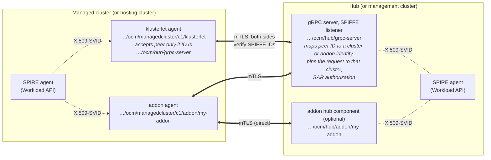

# SPIFFE Mutual Identity for Hub, Klusterlet and Addons

## Release Signoff Checklist

- [ ] Enhancement is `implementable`
- [ ] Design details are appropriately documented from clear requirements
- [ ] Test plan is defined
- [ ] Graduation criteria for dev preview, tech preview, GA
- [ ] User-facing documentation is created in [website](https://github.com/open-cluster-management-io/open-cluster-management-io.github.io/)

## Summary

This enhancement adds a `spiffe` registration driver that treats OCM's agents and hub components as
ordinary [SPIFFE](https://spiffe.io/docs/latest/spiffe-about/spiffe-concepts/) workloads.

In OCM today a managed cluster *earns* an identity: it presents a bootstrap credential, requests a
certificate, and the hub signs it with its own CA. With the `spiffe` driver, every OCM component
**already has** an identity, issued by SPIRE from where and how it runs. Components use those
identities to **authenticate each other on every connection**:

- The klusterlet agent proves it is `spiffe://<td>/ocm/managedcluster/<c>/klusterlet`, and accepts
  the hub only if the hub proves it is `spiffe://<td>/ocm/hub/grpc-server`.
- An addon agent proves it is `…/ocm/managedcluster/<c>/addon/<a>`, and accepts only the hub, or
  its own addon hub component, by SPIFFE ID.
- The hub maps each verified SPIFFE ID to the cluster or addon it belongs to. A component can act
  only as itself.

Registration reduces to recording which SPIFFE ID a `ManagedCluster` is bound to, and accepting it.
OCM issues no credentials, runs no certificate authority and stores no credentials.

The design covers every deploy mode: Klusterlet `Default`, `Singleton`, `Hosted` and
`SingletonHosted`, and ClusterManager `Default` and `Hosted`.

## Motivation

OCM's registration drivers all follow the same pattern: bootstrap credential → certificate or
token issued by the hub → credential stored in a Secret → rotation before expiry. With the `grpc`
driver ([KEP 141](../141-grpc-based-registration/README.md)) that means:

| Where | Object | Contents |
|---|---|---|
| Hub | Secret `signer-secret` | OCM CA certificate and private key (365 days), signing agent certificates, the gRPC serving certificate and webhook serving certificates |
| Hub | ConfigMap `ca-bundle-configmap`; serving-certificate Secrets | CA certificates; TLS certificates and keys |
| Hub | Secret `bootstrap-token-ocmhub` (optional) | Bootstrap token |
| Spoke | Bootstrap Secret; `hub-kubeconfig-secret` | Hub CA and bootstrap token; agent certificate and key (up to 30 days) |
| Spoke | `<addon>-hub-kubeconfig` | Addon certificate and key, or a ServiceAccount token |
| Hosting cluster (Hosted Klusterlet) | `external-managed-kubeconfig` | Credential for the managed cluster's kube-apiserver, usually admin |
| Management cluster (Hosted ClusterManager) | `external-hub-kubeconfig`, `*-sa-kubeconfig` | Hub admin credential; 360-day ServiceAccount tokens |

The problems:

- **Identity comes from holding a credential, not from the workload.** Whoever holds the bootstrap
  token, `signer-secret` or a copied `hub-kubeconfig-secret` *is* the cluster as far as the hub is
  concerned.
- **Trust is one-way and pinned to a CA.** Agents trust whatever the OCM CA signed, not a specific
  hub component.
- **Slow revocation.** Agent certificates last up to 30 days, and the gRPC server does not check
  revocation.
- **A second PKI.** Organisations that already run SPIRE must operate, audit and rotate an
  OCM-specific PKI just for OCM.

### Goals

**Requirements:**

| # | Requirement |
|---|---|
| I1 | Every OCM component that crosses a cluster boundary uses a SPIFFE identity obtained from the Workload API. |
| I2 | **Every connection is mutually authenticated.** Each side verifies the other's SPIFFE ID against an expected ID or a mapping, not merely against a CA. |
| I3 | An identity can act **only as itself.** A managed cluster cannot act as another cluster; an addon cannot act as its cluster's klusterlet or as another addon. This holds even if the cluster fully controls its own Kubernetes API. |
| I4 | A `ManagedCluster` is bound to exactly one SPIFFE ID. Rebinding needs an explicit administrator action. |
| C1 | OCM runs **no certificate authority** and issues no certificates. |
| C2 | **No OCM-created Secret or ConfigMap** contains a certificate, a private key or a token. |
| C3 | **No connection outlives its credential.** Connections are re-established with a current SVID before the one that opened them expires. |

**Functional goals:**

- A managed cluster joins, is accepted, renews its lease and receives `ManifestWork` using only
  its SPIFFE identity.
- Addon agents have their own identity and reach the hub, or their addon's hub component, without
  stored credentials and without changes to addon images.
- **All deploy modes:** Klusterlet `Default`, `Singleton`, `Hosted` and `SingletonHosted`;
  ClusterManager `Default` and `Hosted`. Hosted modes have one prerequisite, described in
  [Hosted modes](#hosted-modes).
- One hub can trust several SPIFFE trust domains.
- `clusteradm init` and `clusteradm join` support.
- Clusters move from `csr` or `grpc` to `spiffe` one at a time, without downtime.

### Non-Goals

- **How SPIRE is run.** Installing and operating SPIRE, its CA lifetime, key storage and SVID
  lifetime are the SPIRE administrator's choices. OCM relies only on the
  [requirements below](#spire-requirements).
- **Kubernetes' own control-plane credentials**, such as the kube-apiserver CA and the
  `kube-root-ca.crt` ConfigMap.
- **Changing the existing `csr`, `grpc` or `awsirsa` drivers.**
- **Changes** to the CloudEvents event types or the SubjectAccessReview mapping.

## Proposal

### Overview



1. **Identity.** Each OCM component gets an SVID from its local SPIRE agent. The SPIFFE ID encodes
   the cluster name and, for addons, the addon name.
2. **Mutual authentication.** All hub ↔ agent traffic goes through a dedicated SPIFFE listener on
   the gRPC server, using mTLS with X.509-SVIDs on both sides. Each side authorizes the peer's
   SPIFFE ID.
3. **Registration as identity binding.** The agent announces itself over the authenticated
   connection. The hub creates or updates the `ManagedCluster` named in the SPIFFE ID, records the
   SPIFFE ID on it, and waits for acceptance. No credential is issued.

### Registration: today vs. `spiffe`

| Step | `csr` / `grpc` today | `spiffe` |
|---|---|---|
| Prove who you are | Bootstrap token or kubeconfig, handed out of band | SVID from the Workload API |
| Prove who the hub is | Pinned CA certificate in the bootstrap Secret | Hub's SVID, checked against an expected SPIFFE ID |
| Get a steady-state credential | CSR → approved → signed by the OCM CA → stored in a Secret | None. The SVID is the credential, and SPIRE rotates it |
| Hub records the identity | Certificate subject; join is first-come | `ManagedCluster` is bound to one SPIFFE ID |
| Hub accepts | `hubAcceptsClient=true`, manual or auto-approval | Same; auto-approval can match SPIFFE ID patterns |
| Revoke | Wait up to 30 days, or remove RBAC | Delete the SPIRE entry: connections close within one SVID lifetime. Or remove RBAC: immediate |

### SPIFFE ID scheme

| Component | SPIFFE ID |
|---|---|
| Klusterlet agents (registration, work, or the singleton agent) | `spiffe://<td>/ocm/managedcluster/<c>/klusterlet` |
| Addon agent | `spiffe://<td>/ocm/managedcluster/<c>/addon/<a>` |
| Klusterlet operator on a hosting cluster (Hosted modes) | `spiffe://<td>/ocm/hosting/<h>/klusterlet-operator` |
| gRPC server | `spiffe://<td>/ocm/hub/grpc-server` |
| Hub webhooks | `spiffe://<td>/ocm/hub/{registration,work,addon}-webhook` |
| Addon hub component | `spiffe://<td>/ocm/hub/addon/<a>` |
| Cluster-manager operator and hub controllers (Hosted ClusterManager only) | `spiffe://<td>/ocm/hub/<component>` |

`<c>`, `<h>` and `<a>` must be DNS-1123 labels: at most 63 characters, only lowercase letters,
digits and `-`, starting and ending with a letter or digit (`[a-z0-9]([-a-z0-9]*[a-z0-9])?`, as
checked by `validation.IsDNS1123Label` in `k8s.io/apimachinery`). Each name appears as one segment
of a SPIFFE ID path and as one field of a `:`-separated OCM username, which
`ValidateClusterIdentity` splits on `:`. Because a DNS-1123 label cannot contain `/` or `:`, a name
always fills exactly one segment in both formats, so a crafted name cannot be read as a different
cluster or addon. The hub rejects SPIFFE IDs whose name segments are not valid labels.

The `/ocm/managedcluster` prefix is configurable.

> **Note:** The examples use a single trust domain, `<td>`, for the hub and all managed clusters.
> The hub and the managed clusters can also be in different trust domains, for example one per
> environment or per cluster, as long as the trust domains are federated (see
> [SPIRE requirements](#spire-requirements)). The hub lists every trust domain it accepts in
> `trustDomains`, and each agent verifies the hub against the full SPIFFE ID in `serverID`,
> including its trust domain.

#### Mapping to OCM identities

The hub maps an authenticated SPIFFE ID to the user and group strings that OCM's existing
authorization already understands:

| SPIFFE ID | User | Groups |
|---|---|---|
| `…/ocm/managedcluster/<c>/klusterlet` | `system:open-cluster-management:<c>:klusterlet` | `system:open-cluster-management:<c>`, `system:open-cluster-management:managed-clusters`, `open-cluster-management:spiffe-bootstrappers` |
| `…/ocm/managedcluster/<c>/addon/<a>` | `system:open-cluster-management:cluster:<c>:addon:<a>:agent:<a>-agent` | `system:open-cluster-management:cluster:<c>:addon:<a>`, `system:open-cluster-management:addon:<a>` |

Rules:
- Every other SPIFFE ID is rejected. A raw SPIFFE ID is never used as a username, because
  `ValidateClusterIdentity` only checks identities with the `system:open-cluster-management:`
  prefix and would let it through unpinned.
- Both user formats are ones `ValidateClusterIdentity` already parses, so every request is pinned
  to the cluster named in the SPIFFE ID before authorization runs (I3).
- The groups are the ones CSR-issued certificates carry today, and the addon strings match
  addon-framework's `agent.DefaultUser` and `agent.DefaultGroups`. Existing RBAC and the
  SubjectAccessReview authorizer apply unchanged.

### SPIRE requirements

OCM relies on three things from SPIRE:

1. **Identity isolation.** I3 is only as strong as this:

   > **An SVID under `/ocm/managedcluster/<c>/` can be issued only to workloads on the cluster
   > that runs `<c>`'s agents**: the managed cluster itself or, in Hosted modes, its hosting
   > cluster.

   In a trust domain shared by several clusters, this means each cluster's SPIRE agents attest
   directly to the shared server (for example with `k8s_psat`), and every OCM entry for `<c>` is
   parented to that cluster's node alias. A nested SPIRE server, or SPIRE Controller Manager, on a
   spoke that shares a trust domain with other clusters breaks it.

   In Hosted modes the hosting cluster can obtain the identity of every cluster it hosts. It
   already runs those agents, and today it holds their kubeconfigs; here the SPIRE administrator
   grants it explicitly, entry by entry.
2. **Federation** when the hub and spokes are in different trust domains, so each side has the
   other's bundle.
3. **Workload API access** in OCM pods, for example through the
   [SPIFFE CSI driver](https://github.com/spiffe/spiffe-csi). For Hosted modes, SPIRE must also
   issue JWT-SVIDs whose issuer the remote kube-apiserver can trust.

### User Stories

#### Story 1: Hub administrator sets up the hub

The SPIRE administrator has created entries for the hub components. The hub administrator runs:

```bash
clusteradm init --registration-drivers spiffe \
  --spiffe-trust-domain onprem.example.org \
  --spiffe-trust-domain cloud.example.org \
  --spiffe-auto-approve 'spiffe://onprem.example.org/ocm/managedcluster/prod-eu-*/klusterlet'
```

The cluster-manager operator deploys the gRPC server with a SPIFFE listener and the webhooks with
SVID-based TLS. It creates no CA, no serving-certificate Secrets and no bootstrap token.

#### Story 2: Managed cluster administrator joins a cluster

The SPIRE administrator has created the cluster's OCM entries. The managed cluster administrator
runs:

```bash
clusteradm join --cluster-name prod-eu-1 --registration-auth spiffe \
  --hub-grpc-url grpc.hub.example.com:443 \
  --hub-spiffe-id spiffe://cloud.example.org/ocm/hub/grpc-server
```

There is nothing secret to pass, so there is no bootstrap Secret: the URL and the hub's SPIFFE ID
go in the `Klusterlet` spec. The agent connects, accepts the server only if it presents the
expected ID, and announces itself. The hub creates `ManagedCluster/prod-eu-1` bound to the agent's
SPIFFE ID.

#### Story 3: Hub administrator accepts the cluster

A hub administrator checks the bound SPIFFE ID in `clusteradm get clusters` and runs
`clusteradm accept --clusters prod-eu-1`, or auto-approval matches the SPIFFE ID. The cluster
starts syncing. No certificate is requested or issued.

#### Story 4: Hosted klusterlet

Cluster `edge-7` is managed in `Hosted` mode from hosting cluster `mgmt-1`. Its kube-apiserver
trusts the SPIRE JWT issuer. The `edge-7` administrator grants the hosting operator's SPIFFE ID
access once, with a `ClusterRoleBinding`. The hosting administrator creates the `Klusterlet` with
`edge-7`'s apiserver URL. No kubeconfig is handed over.

#### Story 5: An addon agent and its hub component

The `my-addon` agent connects to its own hub component. The agent accepts only
`spiffe://<td>/ocm/hub/addon/my-addon`; the hub component accepts only
`…/ocm/managedcluster/*/addon/my-addon` and learns the cluster name from the peer's SPIFFE ID.

#### Story 6: Mixed on-prem and cloud fleet

On-prem clusters are in `onprem.example.org` and cloud clusters in `cloud.example.org`, each served
by its own SPIRE deployment. The two federate. One hub trusts both trust domains, and neither
environment can mint the other's identities.

### Implementation Details/Notes/Constraints

#### The SPIFFE listener (gRPC server)

The gRPC server gets a second listener, enabled when the `spiffe` driver is on:

- **Port.** Separate from the existing listener (default `8091`), so `grpc` clients that pin the
  OCM CA keep working during migration. The operator removes the old listener and the OCM CA once
  no other driver is enabled (see [Upgrade](#upgrade--downgrade-strategy)).
- **TLS.** go-spiffe `tlsconfig.MTLSServerConfig` with a `workloadapi.X509Source`, and an
  authorizer that accepts only the configured trust domains and path prefix.
- **Authentication.** A new `SPIFFEAuthenticator` in `sdk-go/pkg/server/grpc/authn` reads the
  SPIFFE ID from the peer certificate, applies the [mapping table](#mapping-to-ocm-identities), and
  records the certificate's expiry in the context. The existing SAR authorizers follow unchanged.
- **Connection lifetime (C3).** A TLS connection, and a `Subscribe` stream, stay open after the
  certificate that opened them expires. The listener closes each stream when the peer certificate
  expires and sets `MaxConnectionAge` below the SVID lifetime. The CloudEvents client already
  reconnects and resyncs.
- **Load balancers** in front of it must pass TLS through at layer 4.

#### Agent side: the `spiffe` registration driver

A new `RegisterDriver` in `pkg/registration/register/spiffe`, selected by `authType: spiffe`:

- **Client.** sdk-go `GRPCConfig` gains a `spiffe` block (`socketPath`, `serverID`). The client
  dials with `tlsconfig.MTLSClientConfig(x509Source, bundleSource, tlsconfig.AuthorizeID(serverID))`.
- **Configuration** is rendered by the klusterlet operator from the `Klusterlet` spec. There is no
  bootstrap Secret; bootstrap and steady-state configuration are the same.
- **`Process`** sends no CSR. It reports registration complete once the cluster is accepted.
- **`IsHubKubeConfigValid`** checks that the agent's SVID is
  `…/ocm/managedcluster/<clusterName>/klusterlet`. A missing or wrong SPIRE entry is reported on a
  Klusterlet condition.
- **`Fork`** returns the addon `spiffe` driver.

#### Identity binding on the hub

When a SPIFFE-authenticated caller creates or updates a `ManagedCluster`, the gRPC cluster service:

- sets `open-cluster-management.io/spiffe-id` to the authenticated SPIFFE ID, overwriting any
  client-supplied value;
- **rejects** the request if the cluster is already bound to a different SPIFFE ID (I4), for
  example the same cluster name appearing in a second trust domain.

The registration webhook allows changes to the annotation only from the gRPC server and from
administrators with a dedicated `rebind` permission. `clusteradm rebind` performs that change.

#### Hub registration driver

`SPIFFEHubDriver`:
- runs no CSR controllers;
- **`Accept`** matches the bound SPIFFE ID against `autoApprovedIdentities` (exact IDs or `*` path
  segments);
- **`CreatePermissions`** and **`Cleanup`** are no-ops, because per-cluster RBAC is group-based.

The cluster-manager operator binds `open-cluster-management:spiffe-bootstrappers` to the existing
`open-cluster-management:bootstrap` `ClusterRole`. Because requests are pinned to the cluster in the
SPIFFE ID, a cluster that has not yet been accepted can only create or read its own
`ManagedCluster`.

#### Hub webhooks

The registration, work and addon webhooks serve TLS with their SVIDs, loaded from
`workloadapi.X509Source` through controller-runtime's `webhook.Options.TLSOpts`. Each webhook's
SPIRE entry carries a DNS SAN for its Service, or for its external address in Hosted ClusterManager
mode.

The kube-apiserver verifies webhooks against the `caBundle` field on their configuration objects.
The cluster-manager operator keeps that field in sync with the hub trust domain's X.509 bundle from
its own Workload API, including SPIRE's pre-published next CA. This is the one link where only one
side is verified, because the kube-apiserver is not a SPIFFE workload.

The certificate-rotation controller does not run, and `signer-secret`, `ca-bundle-configmap` and
the serving-certificate Secrets are never created.

#### Addon identities

Every addon agent has its own SPIFFE ID and is mapped to the addon's existing OCM identity. Addons
use it in up to three ways:

1. **Addon agent ↔ gRPC server.** Addon status, lease and events go through the gRPC server's
   existing addon services, authenticated by the addon's own SVID. The klusterlet and the addon
   cannot act for each other.
2. **Addon agent ↔ addon hub component.** A new `pkg/addon/spiffe` helper in addon-framework gives
   both sides a ready mTLS configuration:
   - `AgentTLSConfig(addonName)` accepts only `spiffe://<td>/ocm/hub/addon/<a>`;
   - `HubTLSConfig(addonName)` accepts only `…/ocm/managedcluster/*/addon/<a>`, and
     `ClusterFromPeer(ctx)` returns the cluster name from the peer's SPIFFE ID.
3. **Addon agent → hub kube-apiserver**, only for addons that watch hub resources directly. This
   builds on the ServiceAccount model of
   [KEP 167](../167-token-based-addon-registration/README.md):
   - The addon manager creates the addon ServiceAccount `<c>-<a>-agent`, and a `Role` that allows
     `create` on `serviceaccounts/token` for that ServiceAccount only, bound to the addon's group.
   - A token-helper sidecar (the `spiffe-addon-token` subcommand of the registration binary)
     exchanges the addon's SVID for a ServiceAccount token through the gRPC server's `TokenRequest`
     service, and writes it to an in-memory `emptyDir`. The addon's kubeconfig refers to that file,
     so the addon image is unchanged.

The addon manager injects the Workload API volume, and the sidecar where needed, into template
addons. addon-framework addons opt in through a helper in their manifest function.

#### Hosted modes

In Hosted modes the agents run on one cluster and manage another. Their path to the hub is the same
as in every other mode. What Hosted modes add is a **remote kube-apiserver**: the managed cluster's
(Hosted Klusterlet) or the hub's (Hosted ClusterManager). Today that is reached with a stored
kubeconfig.

With `spiffe`, components reach the remote kube-apiserver with their own JWT-SVIDs:

- **Prerequisite.** The remote kube-apiserver trusts the SPIRE JWT issuer, through
  `AuthenticationConfiguration` (Kubernetes 1.30+) or the provider's OIDC identity-provider
  setting, with the username mapped from the SPIFFE ID (`claims.sub`) and a prefix such as
  `spiffe:`.
- **Client.** The operator builds the client configuration with an `exec` credential plugin
  (`ocm-spiffe-credential`) that fetches a JWT-SVID from the Workload API. No token is stored.
- **Verifying the remote apiserver** is set in the spec as `serverTrust`: `SPIFFE` (the apiserver
  serves an X.509-SVID and is checked against its expected ID), `SystemRoots`, or `CABundle` (the
  apiserver's own CA, in the CR spec).

**Hosted and SingletonHosted Klusterlet:**

1. The managed cluster administrator binds `spiffe:spiffe://<td>/ocm/hosting/<h>/klusterlet-operator`
   to a `ClusterRole` that lets the operator install OCM's CRDs, namespace and agent RBAC. This
   one-time, revocable binding replaces handing over an admin kubeconfig.
2. The klusterlet operator uses its SVID to install those resources, binding the agent RBAC to
   `spiffe:spiffe://<td>/ocm/managedcluster/<c>/klusterlet`.
3. The agents reach the managed cluster with their JWT-SVIDs, and the hub with mTLS.
   `external-managed-kubeconfig` is not used.

**Hosted ClusterManager:**

1. The hub administrator binds `spiffe:spiffe://<td>/ocm/hub/cluster-manager` to a role on the
   hub.
2. The cluster-manager operator deploys the hub controllers on the management cluster, each with
   its own SPIFFE ID, and installs hub RBAC for those IDs. `external-hub-kubeconfig` and the
   `*-sa-kubeconfig` Secrets are not used.
3. The gRPC server and webhooks run on the management cluster with SVIDs, as in `Default` mode.

A cluster whose kube-apiserver cannot trust an external JWT issuer can still use `spiffe` in
`Default` or `Singleton` mode, but cannot be the managed cluster in Hosted Klusterlet mode or the
hub in Hosted ClusterManager mode.

#### API changes

**ClusterManager.** `RegistrationDriverHub.AuthType` gains `spiffe`, with a matching member:

```go
type SPIFFEHubConfig struct {
    // Trust domains whose SPIFFE IDs may register clusters and addons.
    // +kubebuilder:validation:MinItems=1
    TrustDomains []string `json:"trustDomains"`

    // Exact SPIFFE IDs, or IDs with '*' path segments, matched against the bound SPIFFE ID.
    // +optional
    AutoApprovedIdentities []string `json:"autoApprovedIdentities,omitempty"`

    // +kubebuilder:default="/ocm/managedcluster"
    PathPrefix string `json:"pathPrefix,omitempty"`
}
```

For Hosted ClusterManager, `HostedClusterManagerConfiguration` gains
`HubAPIServer *SPIFFERemoteAPIServer`.

**Klusterlet.** `RegistrationDriver.AuthType` gains `spiffe`, with a matching member:

```go
type SPIFFEAgentConfig struct {
    // gRPC server SPIFFE listener address (host:port).
    ServerURL string `json:"serverURL"`
    // SPIFFE ID the gRPC server must present.
    ServerID string `json:"serverID"`
    // +kubebuilder:default="/ocm/managedcluster"
    PathPrefix string `json:"pathPrefix,omitempty"`
}
```

For Hosted and SingletonHosted, `Klusterlet.spec` gains
`ManagedClusterAPIServer *SPIFFERemoteAPIServer`.

Shared type:

```go
// +kubebuilder:validation:XValidation:rule="self.serverTrust != 'SPIFFE' || has(self.serverID)"
// +kubebuilder:validation:XValidation:rule="self.serverTrust != 'CABundle' || has(self.caBundle)"
type SPIFFERemoteAPIServer struct {
    URL string `json:"url"`
    // Audience of the JWT-SVIDs, as configured in the remote AuthenticationConfiguration.
    Audience string `json:"audience"`
    // +kubebuilder:validation:Enum=SPIFFE;SystemRoots;CABundle
    ServerTrust string `json:"serverTrust"`
    // +optional
    ServerID string `json:"serverID,omitempty"`
    // +optional
    CABundle []byte `json:"caBundle,omitempty"`
}
```

CEL rules require `managedClusterAPIServer` for Hosted/SingletonHosted Klusterlets using `spiffe`,
and `hubAPIServer` for Hosted ClusterManagers using `spiffe`.

`AddOnRegistrationDriver.AuthType` and `ManagedClusterAddOn` `KubeClientConfig.Driver` gain
`spiffe`.

All types land in `open-cluster-management-io/api` first.

#### SPIRE entries

Example entries, created by the SPIRE administrator:

```bash
# Hub
spire-server entry create -spiffeID spiffe://cloud.example.org/ocm/hub/grpc-server \
  -parentID <hub-node-alias> \
  -selector k8s:ns:open-cluster-management-hub -selector k8s:sa:grpc-server-sa
spire-server entry create -spiffeID spiffe://cloud.example.org/ocm/hub/registration-webhook \
  -parentID <hub-node-alias> \
  -selector k8s:ns:open-cluster-management-hub -selector k8s:sa:registration-webhook-sa \
  -dns cluster-manager-registration-webhook.open-cluster-management-hub.svc

# Managed cluster prod-eu-1
for sa in klusterlet-registration-sa klusterlet-work-sa; do
  spire-server entry create \
    -spiffeID spiffe://onprem.example.org/ocm/managedcluster/prod-eu-1/klusterlet \
    -parentID <prod-eu-1-node-alias> \
    -selector k8s:ns:open-cluster-management-agent -selector k8s:sa:$sa
done
spire-server entry create \
  -spiffeID spiffe://onprem.example.org/ocm/managedcluster/prod-eu-1/addon/my-addon \
  -parentID <prod-eu-1-node-alias> \
  -selector k8s:ns:open-cluster-management-agent-addon -selector k8s:sa:my-addon-agent-sa

# Hosted cluster edge-7, running on mgmt-1: parented to the hosting cluster
spire-server entry create \
  -spiffeID spiffe://onprem.example.org/ocm/managedcluster/edge-7/klusterlet \
  -parentID <mgmt-1-node-alias> \
  -selector k8s:ns:klusterlet-edge-7 -selector k8s:sa:klusterlet-agent-sa
```

#### Revocation

- Deleting a cluster's SPIRE entries stops new SVIDs; existing connections close when their SVID
  expires.
- Setting `hubAcceptsClient=false` removes the cluster's RBAC immediately.
- Clearing the binding (`clusteradm rebind --clear`) blocks the old SPIFFE ID immediately.

### Risks and Mitigation

| Risk | Impact | Mitigation |
|---|---|---|
| SPIRE configuration lets one spoke obtain another cluster's IDs | Cross-cluster impersonation | Documented isolation requirement; identity binding (I4) catches a second trust domain claiming a bound name |
| Authenticator lets an unmapped identity through | Bypasses `ValidateClusterIdentity` | Reject everything outside the mapping table; tests assert this |
| SPIRE unavailable | No new connections once SVIDs expire | SPIRE's own availability; the existing lease grace period |
| Webhook `caBundle` falls behind a CA rotation | Webhook calls fail | Sync on every bundle change, including the pre-published next CA |
| Hosting cluster compromised | It can act as every cluster it hosts | Same as today with stored kubeconfigs, but granted explicitly per entry |
| Remote apiserver can't trust an external JWT issuer | Hosted modes unavailable for that cluster | `Default`/`Singleton` modes |

## Design Details

### Open Questions

1. **Addons that need the hub kube-apiserver.** They still need a ServiceAccount token and the hub
   apiserver's CA. Should such addons instead reach hub resources only through the gRPC server?
2. **Entry management.** Should a hub controller with SPIRE server API access create cluster and
   addon entries from `ManagedCluster` and `ManagedClusterAddOn` objects? This would make join a
   single step, but would give the hub write access to SPIRE.

### Test Plan

- **Unit (sdk-go):** the authenticator with valid, expired, wrong-trust-domain and unmapped-path
  SVIDs; closing streams at expiry; the client rejecting a server with a different SPIFFE ID.
- **Unit (ocm):** the `spiffe` register and hub drivers; identity binding and rebinding; TokenRequest
  restrictions; webhook `caBundle` sync; the exec credential plugin; the CEL rules; the
  addon-framework helper.
- **Integration (envtest):** the gRPC server with a fake Workload API. Cover join, binding,
  acceptance, sync, reconnect at SVID expiry, CA rotation, the addon token exchange, and
  impersonation attempts that must fail: another cluster's name, an addon acting as its klusterlet,
  and a second trust domain claiming a bound name.
- **E2E (kind):**
  - Two federated SPIRE trust domains with short SVID and CA lifetimes, to exercise rotation.
  - Klusterlet `Default`, `Singleton` and `Hosted`, plus Hosted ClusterManager, using kind clusters
    whose apiservers trust the SPIRE issuer.
  - A template addon, and an addon using the direct mTLS helper.
  - A check that no Secret or ConfigMap in the OCM namespaces contains a PEM block or token, and
    that no token Secrets exist (C2).

### Graduation Criteria

**Alpha:**
- the SPIFFE listener, authenticator and client in sdk-go;
- the `spiffe` register and hub drivers, behind a feature gate;
- identity binding;
- Klusterlet `Default` and `Singleton`;
- integration tests.

**Beta:**
- webhooks on SVIDs;
- addon identities;
- Hosted Klusterlet and Hosted ClusterManager;
- `clusteradm` support;
- full e2e;
- a reconnect scale test at 1,000 clusters.

**GA:**
- two production adopters;
- a security review including a SPIFFE/SPIRE maintainer;
- the API unchanged for two releases.

### Upgrade / Downgrade Strategy

`spiffe` is a separate driver, so the hub can enable it alongside `csr` or `grpc` and clusters move
one at a time:

1. Add `spiffe` to the ClusterManager's `registrationDrivers`. The operator opens the SPIFFE
   listener next to the existing one.
2. Move each cluster: create its SPIRE entries, then set the Klusterlet to `authType: spiffe`. The
   hub binds the existing `ManagedCluster` to the agent's SPIFFE ID. The cluster group is the same,
   so the cluster stays accepted and no RBAC changes are needed.
3. Move each addon to `spiffe`.
4. Remove the other drivers. The operator refuses while any accepted cluster or addon still uses
   them. Once they are removed, it closes the old listener, stops the CSR signer, deletes
   `signer-secret`, `ca-bundle-configmap`, the serving-certificate Secrets and the bootstrap token,
   and switches the webhooks to SVIDs.

Hosted clusters move by adding `managedClusterAPIServer` (or `hubAPIServer`) together with
`authType: spiffe`. The operator stops using the kubeconfig Secret and deletes the copies it made.

**Downgrade:** re-add `csr` or `grpc`. The operator recreates the CA and serving certificates, after
which clusters can move back.

### Version Skew Strategy

- **A new agent with `authType: spiffe` against a hub without the SPIFFE listener** cannot connect.
  It reports this on a Klusterlet condition and keeps retrying.
- **Old agents** keep using their existing driver and listener. Step 4 of the upgrade is gated on
  none remaining.
- **The addon `spiffe` driver** requires a gRPC server and an addon manager that support it.
  Otherwise the addon stays unregistered with a condition, and the cluster's own registration is
  unaffected.

## Implementation History

- 2026-10-31: Initial proposal, as SPIFFE credentials for the `grpc` driver.
- 2026-11-02: Reworked as a separate `spiffe` driver built on mutual identity, covering all deploy
  modes and addons.
- 2026-11-02: Simplified to treat OCM components as SPIFFE workloads; SPIRE's own configuration is
  out of scope.

## Drawbacks

- **SPIRE becomes a runtime dependency.** If SPIRE is unavailable for longer than an SVID lifetime,
  agents cannot reconnect. Today's 30-day certificates tolerate outages for longer.
- **The strength of cluster identities depends on SPIRE's configuration**, which OCM cannot verify.
- **Hosted modes need a configurable remote kube-apiserver.**
- **Another registration driver** and a second gRPC listener to maintain.

## Alternatives

- **SPIFFE as a credential option inside the `grpc` driver.** This keeps the bootstrap-and-CSR
  shape, and the shared listener makes the OCM CA hard to retire.
- **JWT-SVIDs instead of X.509-SVIDs from agents to the gRPC server**, with the hub fetching keys
  from the SPIRE OIDC discovery provider. This avoids federating spoke bundles to the hub, but adds
  bearer tokens, audiences and an HTTP dependency. It can be added later with the same mapping
  table if one-way federation turns out to be common.
- **Authenticate SPIFFE at the hub kube-apiserver** with `AuthenticationConfiguration`. This only
  works where the hub apiserver can be configured, puts agents back in front of the apiserver
  (against KEP 141's goal), and agents would still trust a CA rather than a SPIFFE ID.
- **cert-manager with a KMS-backed issuer.** Certificates and keys are still stored in Secrets, and
  identity still comes from holding a credential.
- **A small proxy on the managed cluster for Hosted Klusterlet**, so the remote apiserver needs no
  configuration. It defeats the purpose of Hosted mode.

## References

- [KEP 141: gRPC based registration](../141-grpc-based-registration/README.md)
- [KEP 167: token-based addon registration](../167-token-based-addon-registration/README.md)
- [SPIFFE concepts](https://spiffe.io/docs/latest/spiffe-about/spiffe-concepts/)
- [SPIFFE federation](https://spiffe.io/docs/latest/architecture/federation/readme/)
- [go-spiffe v2](https://github.com/spiffe/go-spiffe)
- [SPIFFE CSI driver](https://github.com/spiffe/spiffe-csi)
- [Kubernetes structured authentication configuration](https://kubernetes.io/docs/reference/access-authn-authz/authentication/#using-authentication-configuration)
